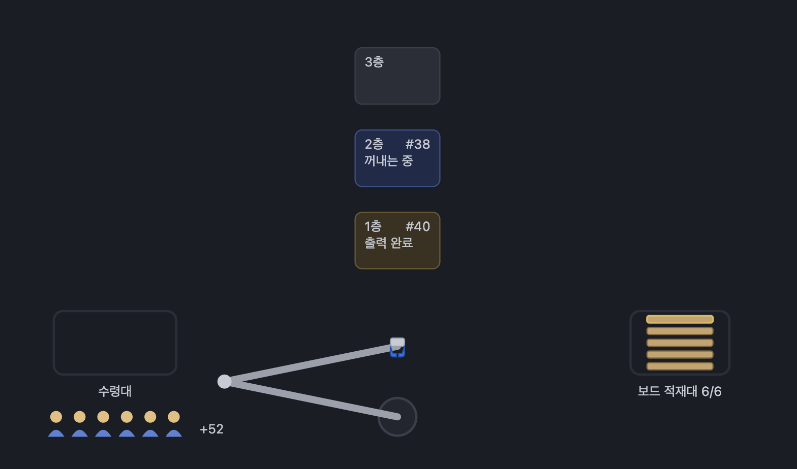
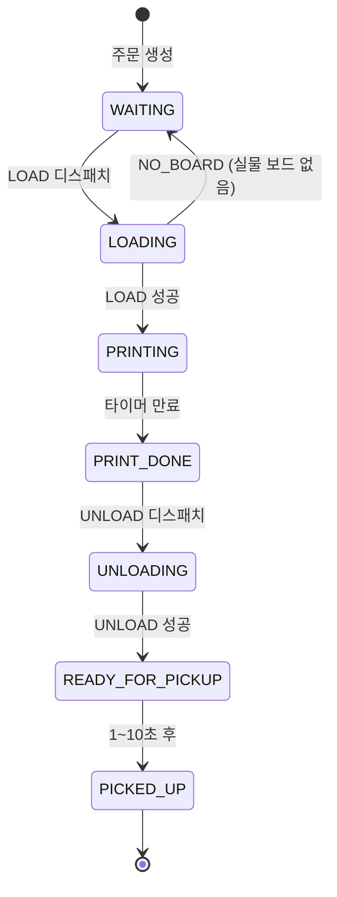
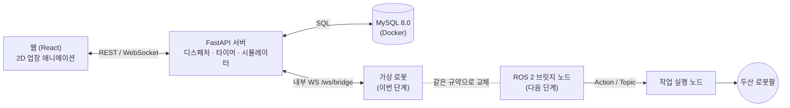

<div align="center">


# 🤖 소규모 3D 프린트 업장 관리 로봇

**두산 로봇팔이 3D 프린터 3대에 보드를 넣고 빼며 주문을 처리하는, 웹 2D 애니메이션 연동 업장 자동화 시스템**


-22314E?style=flat-square&logo=ros&logoColor=white)


</div>

---

##  프로젝트 소개

> 45초마다 손님 주문이 들어오는 소규모 3D 프린트 업장을 로봇팔 1대가 무인으로 운영합니다.
> 서버가 주문·프린터·보드 재고를 관리하며 로봇에게 작업을 하나씩 내려보내고, 로봇의 진행 단계에 맞춰 웹의 2D 업장 애니메이션이 함께 움직입니다.
> 이번 단계에서는 실제 로봇 작업 시간을 반영한 **가상 로봇**으로 전체 흐름을 완성하고, 다음 단계에서 같은 메시지 규약으로 ROS 2와 실물 두산 로봇팔을 연결합니다.

- **기간**: 2026.00.00 ~ 2026.00.00
- **목표**: 주문 접수 → 보드 투입 → 출력 → 회수 → 수령까지 무인 처리, 보드 부족·작업 중 이벤트 등 예외 상황에서도 데이터 불일치 없이 동작
- **데모**: [시연 영상 링크](#)
- **기획 문서**: [PRD](docs/PRD.md)

<!-- 데모 GIF가 있다면 여기에 -->
<!--  -->

### 업장 구성


| 주문 모양 | 출력 시간 |
|:---:|:---:|
| 🔺 세모 | 30초 |
| 🟥 네모 | 40초 |
| ⭐ 별 | 50초 |
| 🔵 동그라미 | 1분 10초 |

---

##  주요 기능

| 기능 | 설명 |
|------|------|
| 🧾 주문 접수 | 45초 간격 자동 주문 + 웹 수동 주문, 랜덤 모양 |
| 🦾 보드 투입 (LOAD) | 빈 프린터가 있을 때만 적재대의 새 보드를 아래층부터 투입 |
| ⏱️ 프린터 타이머 | 보드 투입 완료 시점부터 모양별 출력 시간 카운트 |
| 📦 회수 (UNLOAD) | 출력 완료된 보드를 꺼내 수령대에 놓기, 대기 주문보다 우선 처리 |
| ⏳ 작업 중 이벤트 대기 | 로봇이 일하는 동안 들어온 이벤트는 DB에 쌓였다가 작업이 끝나면 순서대로 처리 |
| 🚨 보드 보충 알럿 | 재고 0이면 로봇에 보내지 않고 "보드를 채워주세요" 알럿, 확인 후 재개 |
| 🔍 실물 보드 없음 감지 | 로봇이 보드를 못 집으면 주문을 대기중으로 되돌리고 재고를 실물 기준으로 맞춤 |
| 🙋 수령 시뮬레이션 | 수령대 도착 후 1~10초 랜덤으로 손님이 가져감 |
| 🎮 2D 업장 애니메이션 | 로봇 진행 단계(feedback)에 맞춰 웹 로봇팔이 실시간으로 이동 |
| 🧪 장애 주입 | 디버그 패널에서 NO_BOARD·GRIP_FAIL 상황을 만들어 예외 흐름 시연 |

### 주문 상태 흐름



---

## 🧩 시스템 구조



- **서버가 단일 진실 원천**: 주문·프린터·재고·작업 큐 판단은 모두 서버(DB)가 하고, 로봇은 받은 작업 하나만 수행합니다.
- **디스패치 우선순위**: 로봇이 IDLE이 될 때마다 `UNLOAD(출력 완료) > LOAD(대기 주문)` 순으로 다음 작업 1건을 고릅니다.
- **교체 가능한 로봇 계층**: 가상 로봇과 ROS 2 브릿지는 같은 `/ws/bridge` 메시지 규약을 쓰므로, 연동 시 서버·웹 수정이 없습니다.

<details>
<summary>📦 디렉터리 구성 펼쳐보기</summary>

```
.
├── backend/                  # FastAPI 서버
│   ├── app/
│   │   ├── api/              # REST 라우터 (orders, inventory, simulator, debug)
│   │   ├── ws/               # /ws/client, /ws/bridge WebSocket
│   │   ├── dispatcher/       # 작업 우선순위 판단, 로봇 작업 전송
│   │   ├── timers/           # 프린터·수령 타이머, 재시작 복원
│   │   ├── simulator/        # 45초 자동 주문 생성
│   │   └── models/           # SQLAlchemy 모델
│   └── alembic/              # DB 마이그레이션
├── frontend/                 # React + TypeScript + Vite, 2D 업장 화면
├── virtual_robot/            # 가상 로봇 (단계별 지연, 장애 주입)
│   └── config/phases.yaml    # 단계별 작업 시간 설정
├── ros2_ws/src/              # (다음 단계)
│   ├── printshop_interfaces/ # 커스텀 action / msg (ExecuteTask, RobotState)
│   ├── printshop_bridge/     # 서버 ↔ ROS 2 브릿지 노드
│   └── printshop_executor/   # DSR 기반 LOAD/UNLOAD 작업 실행 노드
├── docs/PRD.md
└── docker-compose.yml        # mysql, backend, virtual-robot
```

</details>

<details>
<summary>🦾 로봇 작업 단계 (가상 로봇 기본 시간)</summary>

| 단계 | LOAD (초) | UNLOAD (초) |
|------|:---:|:---:|
| MOVE_TO_STOCK | 3 | — |
| PICK_BOARD | 2 | — |
| CHECK_GRIP | 1 | 1 |
| MOVE_TO_PRINTER | 3 + 층 보정 | 3 + 층 보정 |
| PLACE_IN_PRINTER | 2 | — |
| PICK_FROM_PRINTER | — | 2 |
| MOVE_TO_PICKUP | — | 4 |
| PLACE_AT_PICKUP | — | 2 |
| RETURN_HOME | 3 | 3 |
| **합계** | **14~16** | **15~17** |

층 보정: 1층 0초, 2층 +1초, 3층 +2초. 실제 로봇 측정 후 `virtual_robot/config/phases.yaml`에서 보정합니다.

</details>

---

## 🚀 시작하기

### 요구 사항
- Docker / Docker Compose
- Python 3.12
- Node.js 20+
- (다음 단계) Ubuntu 24.04, ROS 2 Jazzy, doosan-robot2

### 빌드 & 실행

실제 구현은 `app/` 아래 있습니다 (`app/backend`, `app/virtual-robot`, `app/frontend`). 처음 클론한 뒤
아래 스크립트 두 개로 실행할 수 있습니다 (자세한 설명·수동 실행 방법은 [`app/README.md`](app/README.md) 참고).

```bash
# 1. 저장소 클론
git clone https://github.com/<org>/<repo>.git
cd <repo>/app

# 2. 최초 1회 설정 (venv/npm install, .env 생성, MySQL(Docker) 기동, DB 스키마 생성)
./scripts/setup.sh

# 3. 그 이후로는 매번 이것만 실행 (Docker 컨테이너 안 떠있으면 기동 + 백엔드·가상로봇·프론트엔드 실행)
./scripts/run.sh
```

- 백엔드: http://localhost:8000, 프론트엔드: http://localhost:5173
- 종료는 `./scripts/run.sh`가 실행 중인 터미널에서 `Ctrl+C`.

---

##  트러블슈팅

<details>
<summary>❗ 문제 1 — 로봇이 작업 중일 때 들어온 이벤트가 유실되거나 순서가 꼬임</summary>

- **원인**: 주문 생성·출력 완료 이벤트를 메시지로 바로 로봇에 보내면, 로봇이 바쁠 때 이벤트가 버려지거나 중복 실행될 수 있음
- **해결**: 이벤트는 DB 상태로만 남기고, 로봇의 작업 결과를 받을 때마다 디스패처가 `UNLOAD > LOAD` 우선순위를 다시 평가. 동시 실행 작업은 트랜잭션(`SELECT ... FOR UPDATE`)으로 최대 1개 보장
- **배운 점**: 

</details>

<details>
<summary>❗ 문제 2 — 알럿에서 보충 확인을 눌렀는데 실제로는 보드가 없음</summary>

- **원인**: DB 재고와 실물 적재대 수량이 어긋나는 상황 (확인만 누르고 실제로 채우지 않음)
- **해결**: 로봇이 파지 확인 단계에서 `NO_BOARD`를 보고하면 주문을 대기중으로 되돌리고, 슬롯을 비우고, DB 재고를 0으로 맞춘 뒤 알럿을 다시 띄움 (실물 기준으로 정합성 회복)
- **배운 점**: 

</details>

---

##  팀원 소개

<div align="center">

|  |  |  |  |  |
|:---:|:---:|:---:|:---:|:---:|
| [남규진](https://github.com/skarbwls419-art) | [백세웅](https://github.com/tpdnd16-jpg) | [최희범](https://github.com/kcodeusers) | [나연수](https://github.com/I-Am-Na) | [류병옥](https://github.com/devrereg) |
| ROS 2 개발 | ROS 2 개발 | ROS 2 개발 | ROS 2 개발 | 웹 · 서버 · 가상 로봇 |

</div>

---

##  회고 & 다음 단계

- [x] PRD 작성 (요구사항, 상태 머신, 인터페이스 명세)
- [ ] M1 서버 기반: 스키마·시드, 주문·재고 API, 디스패처, 타이머, 자동 주문
- [ ] M2 가상 로봇: `/ws/bridge` 규약, 단계별 작업 시간, 장애 주입, 재접속 복구
- [ ] M3 웹 화면: 2D 업장 레이아웃, 로봇팔 단계 애니메이션, 보충 알럿, 디버그 패널
- [ ] M4 시나리오 테스트·시연: 예외 시퀀스 전체, 30분 연속 운전
- [ ] 다음 단계: ROS 2 브릿지로 가상 로봇 교체, 실물 두산 로봇팔 연동, 실제 작업 시간 측정 및 보정

---

<div align="center">


**⭐ 도움이 됐다면 Star를 눌러주세요!**

</div>