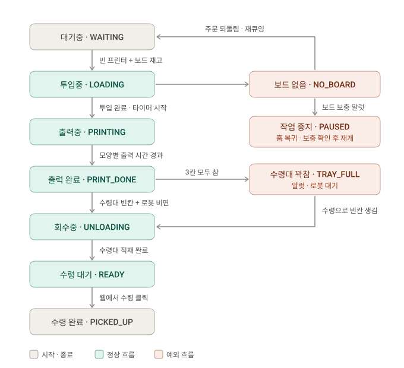
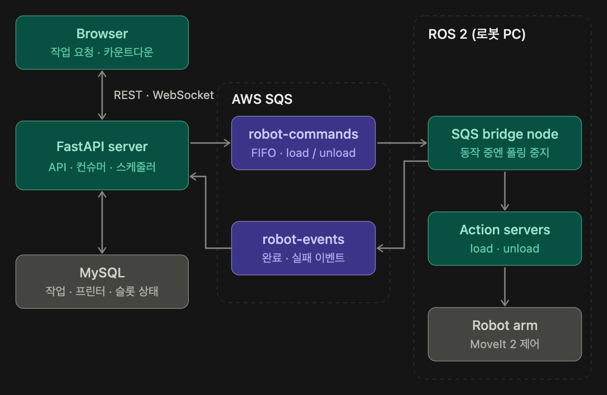

<div align="center">


# [A-2조_징기스칸] 3Farm _ ROKEY 10기


<br/><br/>
</div>


## SKILLS


[](https://v2-manual.scroll.site/ko/v2-programming-manual/2.12.1/publish/drl-basic-syntax)


   


##  프로젝트 소개

```
- 소규모 3D 프린트 업장을 로봇팔 1대가 무인으로 운영합니다.
- 웹 UI를 이용해 두산 로봇팔이 3D 프린터 3대에 보드를 넣고 빼며 주문을 자동으로 처리 합니다.
```

- **기간**: 2026.11.09 ~ 2026.11.20
- **목표**: 
1. 주문 접수 → 보드 투입 → 작업(타이머) → 회수 → 수령까지 무인 처리
2. 보드 부족이나 작업 중 이벤트 등 예외 상황에 대한 대응
3. 로봇의 상태와 작업 처리 상황을 모니터링할 수 있는 웹 대시보드 개발
- **데모**: [시연 영상 링크](#)
- **기획 문서**: [PRD](assets/docs/prd.md)

<!-- 데모 GIF가 있다면 여기에 -->
<!--  -->

### 업장 구성


##  주요 기능

| 기능 | 설명 |
|------|------|
| 🧾 주문 접수 | 유저 이름, 랜덤 모양, 웹 수동 주문 |
| 🦾 보드 투입 | 빈 프린터가 있을 때만 적재대의 새 보드를 아래층부터 투입 |
| ⏱️ 프린터 타이머 | 보드 투입 완료 시점부터 모양별 출력 시간 카운트 |
| 📦 회수 | 작업 완료된 보드를 꺼내 수령대에 놓기 |
| ⏳ 작업 중 이벤트 대기 | 로봇이 일하는 동안 들어온 이벤트는 SQS(큐)에 쌓였다가 작업이 끝나면 순서대로 처리 |
| 🚨 보드 보충 알럿 | 재고 0이 되면 "보드를 채워주세요" 알럿, 확인 후 재개 |
| 🔍 실물 보드 없음 감지 | 로봇이 적재대의 보드를 못 집으면 주문을 대기중으로 되돌리고 SQS(큐)에 재처리 하도록 다시 큐에 넣는다. |
| 🙋 수령 | 유저가 수령대에서 완성물을 수령해가려면 웹 대시보드에서 수령을 누른다 |
| 🎮 웹 대시보드 | 작업 대기(밀려있는 작업 로그), 3D 프린터 작업대 현황(작업 상태), 수령 대기, 적재대 현황, 수령대 현황, 작업 히스토리 |
| 🧪 예외 처리 | NO_BOARD, GRIP_FAIL 상황에 예외 흐름 처리 -> 홈으로 돌아와 문제가 해결될 따까지 작업을 멈춘다. |


### 주문 상태 흐름



## 🧩 시스템 구조



- **server**:   
  - 로봇의 일을 스케쥴링 한다.   
  - 주문, LOAD, UNLOAD, 정지등 작업 이벤트를 발행한다.
- **bridge node**: 
    - 서버로부터 스케쥴을 받아 load, unload 노드에 순차적으로 전달한다.
    - 노드로부터 완료 및 이슈 알림을 받아 서버에 전달한다.

<details>
<summary>📦 디렉터리 구성 펼쳐보기 (프로젝트 마지막에 다시 정리)</summary>

```
.
├── backend/                  # FastAPI 서버
│   ├── app/
│   │   ├── api/              # REST 라우터 (orders, inventory, simulator, debug)
│   │   ├── ws/               # /ws/client, /ws/bridge WebSocket
│   │   ├── dispatcher/       # 작업 우선순위 판단, 로봇 작업 전송
│   │   ├── timers/           # 프린터·수령 타이머, 재시작 복원
│   │   ├── simulator/        # 45초 자동 주문 생성
│   │   └── models/           # SQLAlchemy 모델
│   └── alembic/              # DB 마이그레이션
├── frontend/                 # React + TypeScript + Vite, 2D 업장 화면
├── virtual_robot/            # 가상 로봇 (단계별 지연, 장애 주입)
│   └── config/phases.yaml    # 단계별 작업 시간 설정
├── ros2_ws/src/              # (다음 단계)
│   ├── printshop_interfaces/ # 커스텀 action / msg (ExecuteTask, RobotState)
│   ├── printshop_bridge/     # 서버 ↔ ROS 2 브릿지 노드
│   └── printshop_executor/   # DSR 기반 LOAD/UNLOAD 작업 실행 노드
├── docs/PRD.md
└── docker-compose.yml        # mysql, backend, virtual-robot
```

</details>

<details>
<summary>🦾 로봇 작업 단계 (가상 로봇 기본 시간 -> 측정하면서 업데이트) -> 웹브라우져 시연 제거할지 고민 중...</summary>

| 단계 | LOAD (초) | UNLOAD (초) |
|------|:---:|:---:|
| MOVE_TO_STOCK | 3 | — |
| PICK_BOARD | 2 | — |
| CHECK_GRIP | 1 | 1 |
| MOVE_TO_PRINTER | 3 + 층 보정 | 3 + 층 보정 |
| PLACE_IN_PRINTER | 2 | — |
| PICK_FROM_PRINTER | — | 2 |
| MOVE_TO_PICKUP | — | 4 |
| PLACE_AT_PICKUP | — | 2 |
| RETURN_HOME | 3 | 3 |
| **합계** | **14~16** | **15~17** |

층 보정: 1층 0초, 2층 +1초, 3층 +2초. 실제 로봇 측정 후 `virtual_robot/config/phases.yaml`에서 보정합니다.

</details>


## 🚀 시작하기

### 요구 사항
- Docker / Docker Compose
- Python 3.12
- Node.js 20+
- AWS SQS 엔드포인트 2개, region, accessKey, SecretKey
- Ubuntu 24.04, ROS 2 Jazzy, doosan-robot2


### 웹 빌드 & 실행

실제 구현은 `app/` 아래 있습니다 (`app/backend`, `app/virtual-robot`, `app/frontend`). 처음 클론한 뒤
아래 스크립트 두 개로 실행할 수 있습니다 (자세한 설명·수동 실행 방법은 [`app/README.md`](app/README.md) 참고).

```bash
# 1. 저장소 클론
git clone https://github.com/<org>/<repo>.git
cd <repo>/app

# 2. 최초 1회 설정 (venv/npm install, .env 생성, MySQL(Docker) 기동, DB 스키마 생성)
./scripts/setup.sh

# 3. 이후 매번 이것만 실행 (Docker 컨테이너 안 떠있으면 기동 + 백엔드·가상로봇·프론트엔드 실행)
./scripts/run.sh
```

- 백엔드: http://localhost:8000, 프론트엔드: http://localhost:5173
- 종료는 `./scripts/run.sh`가 실행 중인 터미널에서 `Ctrl+C`.


##  트러블슈팅
프로젝트 진행중 마주했던 문제와 해결방법에 대해 정리합니다.
<details>
<summary>❗ (예시) 문제 1 — 로봇이 작업 중일 때 들어온 이벤트가 유실되거나 순서가 꼬임</summary>

- **원인**: 주문 생성·출력 완료 이벤트를 메시지로 바로 로봇에 보내면, 로봇이 바쁠 때 이벤트가 버려지거나 중복 실행될 수 있음
- **해결**: 이벤트는 DB 상태로만 남기고, 로봇의 작업 결과를 받을 때마다 디스패처가 `UNLOAD > LOAD` 우선순위를 다시 평가. 동시 실행 작업은 트랜잭션(`SELECT ... FOR UPDATE`)으로 최대 1개 보장
- **배운 점**: 

</details>


   
      


##  팀원 소개

<div align="center">

| | 이름 | 역할 |
|:---:|:---|:---|
|  | [남규진](https://github.com/skarbwls419-art) | ROS 2 모듈 개발 / launch.py 파일 작성 및 통합 테스트 QA |
|  | [백세웅](https://github.com/tpdnd16-jpg) | 로봇 팔 동작 구현 (LOAD / UNLOAD) |
|  | [최희범](https://github.com/kcodeusers) | 로봇팔 동작 구현 (LOAD / UNLOAD) |
|  | [나연수](https://github.com/I-Am-Na) | 웹서버와 ROS2 node의 통신 노드 개발 / 인터페이스 정의 |
|  | [류병옥](https://github.com/devrereg) | 시스템 아키텍쳐 설계 / 웹 개발 |

</div>


<div align="center">


**⭐ 맘에 드셨다면 Star를 눌러주세요!**

</div>