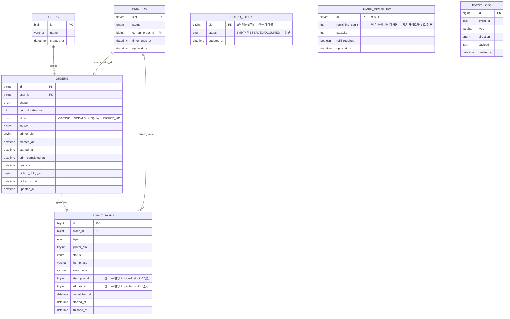

# PRD — 작업요청(SQS 디스패치) 기능

작성일: 2026-11-14 · 작성자: 류병옥 (Claude 보조 작성)

관련 문서: `assets/docs/prd.md`(기존 전체 PRD), `assets/docs/wbs.md`(WBS), `app/ros2_ws/src/sfarm_bridge`(SQS 연동 계약 — ROS 2 담당자 작업물)

## 1. 배경과 목적

기존 PRD(`assets/docs/prd.md`)는 가상 로봇이 내부 WebSocket(`/ws/bridge`)으로 작업을 받는 시뮬레이션 단계를 다룬다. 한편 ROS 2 쪽에서는 이미 AWS SQS(`robot-commands` → 로봇, `robot-events` ← 로봇) 왕복 계약으로 동작을 확인하는 브릿지 노드(`sfarm_bridge.py`)를 만들어 두었다. 이 문서는 웹에서 "작업요청" 버튼으로 주문을 넣으면, 서버가 적재대(베드)와 프린터 빈자리를 확인한 뒤 **SQS로 실제(또는 실물을 흉내 낸) 로봇에 작업을 발행**하는 흐름을 정의한다.

### 목표

- 사용자가 웹에서 유저이름과 작업내용(모양)을 입력해 작업을 요청하면, 서버가 즉시 적재대·프린터 상태를 확인해 가능하면 SQS로 작업을 내려보낸다.
- 적재대에 베드가 없는 경우와 빈 프린터가 없는 경우를 구분해 처리하고, 각각 사용자에게 명확히 알린다.
- SQS 메시지 스키마는 `sfarm_bridge`가 이미 소비하는 `robot-commands` 계약을 그대로 따른다 (ROS 2 쪽 코드 변경 불필요).

### 범위

- 웹 "작업요청" 버튼 → 폼 모달(유저이름, 작업내용) → "요청하기" 제출.
- 서버: 주문 저장 → 베드 확인 → 프린터 빈자리 확인 → (가능하면) `robot-commands` SQS 프로듀싱 → 상태를 "투입중"으로 갱신 → 응답.
- 이 작업요청이 만드는 것은 **LOAD(적재) 디스패치 1건**이다.

### 범위 밖 (이 PRD에서 다루지 않음)

- `robot-events`(SQS) 컨슈머와 그 이후 **주문** 상태 전이(투입중 → 출력중 → …). 로봇이 실제로 LOAD를 완료했다는 응답을 받아 주문·프린터 상태를 바꾸는 로직은 별도 작업으로 남긴다 (10장 참고). *(단, 적재대 재고(`board_stock`)를 최신으로 유지하기 위한 "베드 피킹 완료" 이벤트 소비는 이번 PRD 범위에 포함한다 — 5장 참고.)*
- UNLOAD(수령) 디스패치의 SQS 전환. 이번 PRD는 작업요청(LOAD) 발행만 다룬다.
- 기존 가상 로봇 `/ws/bridge` 경로의 제거·수정. 두 경로의 공존 여부는 10장의 미결 사항이다.
- 로그인, 결제, 다중 매장 (기존 PRD와 동일하게 범위 밖).

### 용어 (기존 PRD 용어에 추가)

| 용어 | 뜻 |
| --- | --- |
| 베드 | 기존 PRD의 "보드"(출력판)와 동일한 개념. `board_inventory` 테이블의 재고 1장 = 보드/베드 1장 |
| 작업요청 | 이 기능에서 쓰는 주문 생성 버튼/흐름의 명칭. 기존 "주문하기"와 동일한 데이터(주문)를 만들지만, 생성 시점에 베드·프린터를 즉시 확인해 SQS로 디스패치까지 시도한다는 점이 다르다 |
| 투입중 | 신규 주문 상태값(`DISPATCHING`). SQS로 LOAD 명령을 보내고 성공을 리턴한 직후부터, 로봇이 실제로 베드를 집었다는 `pick_complete` 이벤트를 받기 전까지의 상태. 그 이벤트를 받으면 기존 `LOADING`으로 넘어간다 (5장 참고) |
| robot-commands | ROS 2 쪽이 구독하는 SQS FIFO 큐. 서버(이 기능)가 LOAD/UNLOAD 명령을 발행(produce)하는 대상 |
| robot-events | ROS 2 쪽이 발행하는 SQS 큐. 명령 완료(`LOAD_COMPLETED`/`UNLOAD_COMPLETED`) 또는 거부(`REJECTED`) 결과가 들어온다 (이번 PRD에서는 컨슈머를 만들지 않으므로 소비하지 않음) |

## 2. 사용자 흐름 (웹)

1. 사용자가 대시보드의 **"작업요청"** 버튼을 누른다.
2. 폼 모달이 뜬다. 입력 필드: **유저이름**(텍스트), **작업내용**(모양 선택 칩 — 세모/네모/별/동그라미, 기존 4종 재사용).
3. **"요청하기"** 버튼을 누르면 서버로 요청을 보낸다.
4. 서버 응답에 따라:
   - 성공(투입중 또는 대기 등록) → 모달 닫힘, 주문이 화면에 반영됨.
   - 베드 없음 → 모달에 에러 메시지 표시("적재대에 베드가 비어있습니다") + 보드 보충 알럿 모달 노출(기존 `alert.refill_required` 흐름 재사용).

기존 `OrderForm`/`OrderModal`(`app/frontend/src/components/organisms/`) 컴포넌트를 그대로 재사용할 수 있다. 바뀌는 것은 버튼·모달 라벨("주문하기"→"작업요청", "작업 넣기"→"요청하기")과 호출하는 API뿐이며, 새 atom/molecule 추가는 필요 없다.

## 3. 서버 처리 로직 (요청 1건)

요청이 들어오면 아래 순서로 **하나의 흐름 안에서** 판정한다 (기존 `DispatcherService`의 비동기 재평가 루프와 달리, 이 요청 자체가 즉시 판정까지 수행한다).

```
1. orders 테이블에 INSERT (status=WAITING, source=MANUAL)
     └─ 커밋. 이후 단계가 실패해도 이 주문 행은 남는다.

2. 베드(board_stock) 확인
     └─ status='OCCUPIED'인 슬롯이 하나도 없으면:
          - 웹에 alert.refill_required(reason=BOARD_STOCK_EMPTY) 브로드캐스트
          - API 응답: 4xx 에러 (주문은 WAITING으로 남아 대기 목록에 있음)
          - 종료

3. 빈 프린터(printers.status=EMPTY) 확인
     └─ 없으면:
          - 추가 조치 없음. 주문은 이미 WAITING이므로 대기 목록에 그대로 있음
          - API 응답: 성공(201), 주문 status=WAITING
          - 종료

4. 베드 있음 + 빈 프린터 있음
     └─ 트랜잭션:
          - printers: 해당 슬롯 EMPTY → RESERVED, current_order_id=주문 id
          - robot_tasks: LOAD 작업 행 생성 (status=DISPATCHED), id 확보를 위해 flush
          - orders.status = WAITING → DISPATCHING ("투입중"), printer_slot 기록
        커밋 전에 SQS robot-commands에 메시지 produce (7장 스키마)
          - produce 성공 → 커밋, 웹에 order.updated/printer.updated/board_stock.updated 브로드캐스트, API 응답 성공(201, status=DISPATCHING)
          - produce 실패(SQS 오류) → 트랜잭션 롤백(슬롯·상태를 원래대로), API 응답 5xx
```

베드 확인(2단계)이 프린터 확인(3단계)보다 먼저라는 순서는 사용자가 준 요구사항 그대로다 — 베드가 없으면 빈 프린터가 있어도 에러로 처리한다.

### 설계 메모 (기존 코드와의 관계)

- 1단계는 기존 `OrderService.create_order`(`app/backend/app/services/order_service.py`)를 그대로 쓸 수 있다.
- 2~4단계는 기존 `DispatcherService._try_reserve_load`(`app/backend/app/services/dispatcher_service.py:109`)와 거의 같은 판정 로직이지만, **그 자리에서 즉시** 판정하고 **SQS로** 보낸다는 점이 다르다. 새 서비스(예: `WorkRequestService`)로 분리하거나, `DispatcherService`에 SQS 전송 어댑터를 추가하는 두 가지 구현 방법이 있다 — 10장 미결 사항 참고.
- SQS produce 실패 시 롤백하는 패턴은 기존 `DispatcherService._revert_unsent_task`(`app/backend/app/services/dispatcher_service.py:147`)와 동일한 전략(디스패치 직후 전송 실패 시 원복)을 따른다.

## 4. 기능 요구사항

| ID | 기능 | 상세 | 우선순위 |
| --- | --- | --- | --- |
| WR-01 | 작업요청 버튼/모달 | 유저이름 + 작업내용(모양) 입력, "요청하기" 제출. 기존 OrderForm/OrderModal 재사용 | P0 |
| WR-02 | 주문 저장 | 요청 즉시 orders INSERT (WAITING) | P0 |
| WR-03 | 베드 없음 처리 | 재고 0 또는 refill_required 시 에러 응답 + alert.refill_required 브로드캐스트. 주문은 WAITING 유지 | P0 |
| WR-04 | 빈 프린터 없음 처리 | 베드는 있으나 빈 프린터 없음 → 주문 WAITING 유지, 성공 응답(대기 등록) | P0 |
| WR-05 | SQS 디스패치 | 베드·프린터 모두 가능 시 robot_tasks(LOAD) 생성, robot-commands에 produce, 성공 시 커밋 | P0 |
| WR-06 | 상태 갱신 | 디스패치 성공 시 orders.status=DISPATCHING("투입중"), printers.status=RESERVED | P0 |
| WR-07 | 실시간 반영 | order.updated/printer.updated를 /ws/client로 브로드캐스트 | P0 |
| WR-08 | SQS 전송 실패 복구 | produce 실패 시 트랜잭션 롤백, 주문/프린터를 이전 상태로 원복 | P1 |
| WR-09 | 피킹 완료 이벤트 처리 | `pick_complete` 수신 시 board_stock RESERVED→EMPTY, orders DISPATCHING→LOADING, 웹소켓 브로드캐스트 | P0 |
| WR-10 | 보드 보충 UI | "채우기 완료" 버튼 → board_stock EMPTY 전부 OCCUPIED, 알럿 해제 | P0 |

## 5. 데이터 모델 변경

### orders.status — 상태값 추가

`app/backend/app/enums.py`의 `OrderStatus`에 `DISPATCHING = "DISPATCHING"`(화면 표기: "투입중")을 추가한다. 기존 `LOADING`과는 별도 값이며, 기존 PRD 6장의 화면 표기 매핑 테이블에 아래 행을 추가한다.

| orders.status | 화면 표기 |
| --- | --- |
| DISPATCHING | 투입중 |

Alembic 마이그레이션 필요: MySQL `ENUM('WAITING','LOADING','PRINTING','PRINT_DONE','UNLOADING','READY_FOR_PICKUP','PICKED_UP')`에 `'DISPATCHING'`을 추가한다 (`app/backend/migrations/`).

### robot_tasks — SQS 발행 내용 추적 컬럼 추가

7장 스키마는 `work_id`(=`orders.id`, 이미 있음) 외에 `start_pos_id`·`sd_pos_id`를 body에 담아 보낸다. 이 값은 produce 시점에 서버가 계산한 결과이므로, 추후 `robot-events` 응답과 대조하거나 디버깅할 때 쓸 수 있도록 `robot_tasks`에 같이 기록해 둔다. (MessageDeduplicationId는 `work_id`로부터 항상 다시 계산 가능하므로 별도 컬럼이 필요 없다.)

| 컬럼 | 타입 | 설명 |
| --- | --- | --- |
| start_pos_id | TINYINT NULL | 발행 시점에 선택한 적재대 위치 (1~3) — LOAD 작업에만 해당 |
| sd_pos_id | TINYINT NULL | 발행 시점에 예약한 프린터 빈 위치 (1~3). 기존 `printer_slot` 컬럼과 같은 값이라 중복으로 보일 수 있으나, SQS로 보낸 실제 값을 그대로 남긴다는 의미에서 구분해 둔다 |

### 적재대(보드 스택) 위치 모델 — 신규 테이블 `board_stock` (층 모델로 확정, 2026-11-14 수정)

처음에는 "슬롯 하나에 여러 장이 쌓인다(count)"는 모델로 썼는데, 사용자가 실제 구조를 설명해줘서 바꿨다: **적재대는 프린터와 똑같이 3개 층으로 쌓여 있고, 로봇팔은 항상 맨 위(가장 높은 층)에서 집는다.** 그래서 "몇 장 쌓여 있나"가 아니라 "이 층에 베드가 있나(상태)"만 알면 되고, 모양은 `printers` 테이블과 거의 같다. 리포지토리 전체를 확인했을 때 이런 위치별 모델은 백엔드·프론트엔드·ROS 2 어디에도 없었으므로 신규 테이블이다.

작업요청이 LOAD를 디스패치하는 순간과 로봇이 실제로 그 베드를 들어내는 순간 사이에는 시간차가 있다. 그 사이에 다른 작업요청이 같은 층을 또 고르지 않도록, 프린터의 `EMPTY → RESERVED → PRINTING`과 같은 이유로 중간 상태가 필요하다.

| 컬럼 | 타입 | 설명 |
| --- | --- | --- |
| slot | TINYINT PK | 1(맨 아래)~3(맨 위) |
| status | ENUM('EMPTY','RESERVED','OCCUPIED') | EMPTY: 베드 없음 · OCCUPIED: 베드 있음, 미배정 · RESERVED: 이번 작업요청에 배정되어 SQS 발행까지 끝났지만 로봇이 아직 실제로 집지는 않은 상태 |
| updated_at | DATETIME(3) | |

**상태 전이**

- `OCCUPIED → RESERVED`: 3장 4단계에서 SQS produce와 같은 트랜잭션으로 전환.
- `RESERVED → EMPTY`: 로봇이 실제로 적재대에서 베드를 꺼낸 뒤 bridge node가 보내는 SQS 이벤트를 서버가 소비해서 전환한다 — 바로 아래 "베드 피킹 완료 이벤트" 참고.
- SQS produce 실패 시 `RESERVED → OCCUPIED`로 원복 (printers 롤백과 같은 전략, 3장 참고).

**초기값:** 3개 층 모두 `EMPTY` (사용자 확인: "board_stock 초기값은 0"). 배포 직후에는 운영자가 보드를 보충해야 주문을 받을 수 있다.

**선정 규칙**

- `start_pos_id`: `status='OCCUPIED'`인 가장 큰 slot 번호(맨 위 층)를 쓴다.
- 보충: 사람이 직접 적재대에 베드를 쌓은 뒤 웹 UI에서 "채우기 완료" 버튼을 누르면, 그 시점에 `EMPTY`인 슬롯을 모두 `OCCUPIED`로 바꾼다(아래 "보드 보충" 참고). 수량 입력은 없다 — 사용자가 사실 그대로 확정해준 규칙.

### board_inventory와의 관계 — 동기화하지 않음 (사용자 확정)

처음엔 `board_inventory.remaining_count`를 `board_stock`의 파생값으로 동기화하려 했으나, 사용자가 "적재대의 베드 적재 상태를 따로 관리해야 한다"고 확정해줬다. 그래서 **`board_stock`은 `board_inventory`와 별개로, 독립적으로 관리한다** — 더 이상 동기화하지 않는다. 이 기능(작업요청/SQS 경로)의 베드 판정·보충·표시는 전부 `board_stock`만 보고, `board_inventory.remaining_count`/`refill_required`는 쓰지 않는다. 수량 기반 보충 엔드포인트 `POST /api/inventory/refill`도 이 기능과 함께 폐기한다 (사용자 확정 — 아래 "보드 보충" 참고).

**알아둬야 할 결과:**

- 기존 가상 로봇(`/ws/bridge`) 디스패치 경로(`DispatcherService._try_reserve_load`)는 이번 PRD에서 손대지 않으므로(1장 범위 밖) 계속 `board_inventory`를 읽는다. 즉 두 디스패치 경로가 **서로 다른 베드 재고 테이블**을 보게 된다 — 10장 미결 사항 1번(두 경로의 관계)이 정해지기 전까지는 이 불일치가 그대로 남는다.
- `GET /api/state`, `inventory.updated` 웹소켓 이벤트, 프론트 `InventoryPanel`/`BoardStock`(`app/frontend/src/components/organisms/InventoryPanel.tsx`, `molecules/BoardStock.tsx`)은 지금 모두 `board_inventory`를 읽어서 "남은 보드 n장"을 보여준다. 이 기능이 들어간 뒤에도 그 화면들이 `board_inventory`만 보면 실제 적재대 상태(`board_stock`)와 다른 값을 보여줄 수 있다 — `board_stock` 기반 집계로 전환하는 작업이 필요하다 (11장에 후속 작업으로 추가).
- (참고) 기존 `assets/docs/prd.md`에는 `capacity`가 두 군데서 다르게(10.6은 "3장", 6장 표는 "가정 10") 적혀 있던 기존 불일치가 있었는데, `board_inventory`를 이 기능에서 더 쓰지 않기로 하면서 이 이슈는 자연히 무관해졌다.

### board_stock 변경 시 웹소켓 브로드캐스트

`board_inventory`와 동기화하지 않으므로, `board_stock`이 바뀔 때마다 전용 이벤트 `board_stock.updated`(3개 슬롯 스냅샷 전체)를 새로 보낸다. 기존 `inventory.updated`는 `board_inventory`가 바뀌는 기존 가상 로봇 경로에서만 계속 쓰인다.

### 보드 보충 — "채우기 완료" 버튼 (확정)

수량 입력 없이, 사람이 적재대에 베드를 물리적으로 다 채운 뒤 웹에서 버튼만 누르는 방식으로 확정했다. 기존 `POST /api/inventory/refill`(수량을 받는 방식, `board_inventory` 갱신)은 **이 기능 도입과 함께 폐기한다** (사용자 확정). 대체 엔드포인트를 새로 둔다.

**주의 — 폐기 범위 확인 필요:** `POST /api/inventory/refill`은 지금 기존 가상 로봇(`/ws/bridge`) 경로의 보충 흐름(프론트 `RefillModal.tsx`, `InventoryService.refill`)이 쓰는 엔드포인트이기도 하다. 10장 미결 사항 1번(두 경로 관계)이 "SQS로 완전 대체"로 정해지면 이 폐기가 자연스럽지만, "병행 유지"로 정해지면 가상 로봇 경로용으로는 이 엔드포인트(또는 동등한 것)가 계속 필요하다. 그 결론이 나기 전까지는 엔드포인트 자체를 지우기보다, 이 기능(작업요청/SQS 경로)에서만 더 이상 호출하지 않는 것으로 좁혀 두는 게 안전하다.

| 항목 | 내용 |
| --- | --- |
| 엔드포인트 | `POST /api/board-stock/refill-complete` (가제, 요청 바디 없음) — 기존 `POST /api/inventory/refill`을 대체 |
| 서버 동작 | `board_stock`에서 `status='EMPTY'`인 모든 행을 `OCCUPIED`로 변경 (3칸 전부 채워졌다고 간주). `board_inventory`는 건드리지 않는다 |
| 응답 | 갱신된 `board_stock` 스냅샷 |
| 브로드캐스트 | `board_stock.updated`, `alert.cleared` |

### 베드 피킹 완료 이벤트 (`pick_complete`, 확정)

로봇이 적재대에서 베드를 실제로 집으면 bridge node가 SQS `robot-events` 큐로 아래 메시지를 보내고, 서버가 소비해서 처리한다 (큐 확정 — 사용자 확인).

| 필드 | 값 |
| --- | --- |
| work_id | `orders.id` (= 7장에서 보낸 `work_id`) |
| status | `"pick_complete"` |

```json
{ "work_id": 42, "status": "pick_complete" }
```

**서버 처리:**

1. `work_id`로 해당 `robot_tasks`(type=LOAD, status=DISPATCHED/RUNNING) 조회 → `start_pos_id` 확인.
2. `board_stock[start_pos_id].status`: `RESERVED → EMPTY`.
3. `orders[work_id].status`: `DISPATCHING → LOADING`. `robot_tasks.status`: `DISPATCHED → RUNNING`.
4. 웹소켓으로 `order.updated`(status=`LOADING`) 브로드캐스트해서 UI에 해당 work_id의 진행 상황을 LOADING으로 표시. `board_stock`도 바뀌었으므로 `board_stock.updated`도 같이 보낸다.
5. 알 수 없는 `work_id`이거나 이미 처리된 경우(중복 수신)는 무시한다 — 기존 PRD 9.5의 "중복 이벤트" 원칙과 동일.

이 이벤트 하나가 **`board_stock` 갱신**과 **주문 상태를 LOADING으로 바꾸는 것**을 동시에 처리한다. 그 다음 단계(LOADING → PRINTING, 즉 로봇이 베드를 프린터에 실제로 넣었다는 응답을 받는 부분)는 여전히 이번 PRD 범위 밖이다.

### 변경 후 테이블 목록

| 테이블 | 변경 유형 | 비고 |
| --- | --- | --- |
| `orders` | 컬럼 값 추가 | `status` ENUM에 `DISPATCHING` 추가 |
| `robot_tasks` | 컬럼 추가 | `start_pos_id`, `sd_pos_id` |
| `board_stock` | **신규** | 적재대 층(1~3)별 `EMPTY`/`RESERVED`/`OCCUPIED`, 독립 관리 (board_inventory와 동기화 안 함) |
| `board_inventory` | 이 기능에서는 사용 안 함 | 기존 가상 로봇(`/ws/bridge`) 경로에서만 계속 사용. `POST /api/inventory/refill`은 이 기능과 함께 폐기 |
| `users`, `printers`, `event_logs` | 변경 없음 | 기존 PRD(`assets/docs/prd.md` 6장) 그대로 |

### ERD



`BOARD_STOCK`·`BOARD_INVENTORY`·`EVENT_LOGS`는 다이어그램에 FK 선을 긋지 않았다 — `board_stock`/`board_inventory`는 앱 레벨에서 동기화하는 단일/룩업 테이블이고, `robot_tasks.start_pos_id`/`sd_pos_id`는 기존 `orders.printer_slot`과 같은 패턴으로 FK 제약 없는 스냅샷 값이다.

## 6. API 명세

### POST /api/work-requests (신규, 확정 — 구현됨)

| 항목 | 내용 |
| --- | --- |
| 요청 | `{ "customer_name": "손님-0001", "shape": "TRIANGLE" }` (shape는 세모/네모/별/동그라미 중 하나; null이면 기존처럼 랜덤 배정) |
| 응답 201 (투입중) | `OrderOut` + `status: "DISPATCHING"` |
| 응답 201 (대기 등록) | `OrderOut` + `status: "WAITING"` (빈 프린터 없음) |
| 응답 4xx (베드 없음) | `{ "error_code": "BOARD_EMPTY", "message": "적재대에 베드가 비어있습니다", "order_id": 123 }` |
| 응답 5xx (SQS 전송 실패) | 주문은 WAITING으로 원복, 운영자 확인 필요 |

엔드포인트를 새로 만들지, 기존 `POST /api/orders`를 확장할지는 10장 미결 사항에 달려 있다. 이 표는 "요청/응답에 어떤 정보가 필요한가"를 정의하는 것이고, 실제 경로(path)는 구현 시 확정한다.

## 7. SQS 인터페이스 명세 (robot-commands)

LOAD 명령의 실제 발행 스키마는 아래와 같이 확정한다 (2026-11-14 업데이트). `sfarm_bridge.py`(`app/ros2_ws/src/sfarm_bridge/sfarm_bridge/sfarm_bridge.py`)는 SQS 연결 확인용 에코 노드일 뿐이고 실제 컨슈머가 쓰는 스키마와 다를 수 있으므로, 이 표가 우선한다 — ROS 2 쪽 실제 컨슈머 구현과 반드시 대조 확인 필요 (10장 미결 사항).

| 필드 | 값 |
| --- | --- |
| 큐 | `robot-commands.fifo` |
| MessageGroupId | 고정값 `"load"` — LOAD 명령은 모두 같은 그룹에 들어가 FIFO로 한 번에 하나씩만 처리된다 |
| MessageDeduplicationId | `"load-{work_id}"` |
| body.work_id | 작업요청(주문) 테이블의 id (`orders.id`) |
| body.start_pos_id | 적재대에서 맨 위에 쌓여 있는 베드의 위치 (1, 2, 3 중 하나) |
| body.sd_pos_id | 3D 프린터의 빈 위치 (`printer_slot`, 1, 2, 3 중 하나) |

```json
{
  "work_id": 42,
  "start_pos_id": 1,
  "sd_pos_id": 2
}
```

메시지 그룹을 고정값 `"load"` 하나로 묶었기 때문에, 같은 그룹의 이전 메시지가 처리(또는 가시성 타임아웃 만료)되기 전까지 다음 LOAD 메시지는 큐에서 순서대로만 꺼내진다 — 로봇이 한 번에 하나의 LOAD만 수행한다는 전제와 맞는다. UNLOAD를 이후 SQS로 옮길 때는 별도 그룹(예: `"unload"`)과 dedup id(`"unload-{work_id}"`)를 쓰는 대칭 구조가 될 것으로 예상하나, 이번 PRD 범위 밖이라 확정하지 않는다.

### start_pos_id 결정 규칙

`start_pos_id`는 `board_stock`(5장)에서 `status='OCCUPIED'`인 가장 큰 slot 번호(맨 위 층)로 계산한다. 디스패치 성공 시 해당 슬롯은 `RESERVED`로 바뀌고, 로봇이 실제로 집은 뒤 수신하는 이벤트로 `EMPTY`가 된다 (5장 "베드 피킹 완료 이벤트" 참고). 베드 없음 판정(3장 2단계)은 `board_stock`에 `OCCUPIED` 슬롯이 하나도 없는지로 본다. `board_inventory`는 이 판정에 더 이상 쓰지 않는다(5장 "board_inventory와의 관계" 참고).

### 환경·인프라 의존성

- 백엔드 컨테이너/프로세스에 `boto3` 추가, `COMMAND_QUEUE_URL`(그리고 추후 컨슈머용 `EVENT_QUEUE_URL`), `AWS_REGION` 환경변수 필요. ROS 2 쪽 `.env` 관례(`app/ros2_ws/src/sfarm_bridge/`)와 동일한 큐 URL을 가리켜야 한다.
- 백엔드가 SQS에 `sqs:SendMessage`를 호출할 수 있는 AWS 자격증명(IAM 사용자/역할)이 필요하다. 로컬 개발 환경에서의 자격증명 방식(공유 자격증명 파일, 환경변수 등)은 미결 사항(10장)으로 남긴다.

## 8. 예외 처리

| 상황 | 처리 |
| --- | --- |
| 베드 0장 | 주문 WAITING 유지, 4xx 응답, alert.refill_required(BOARD_STOCK_EMPTY) — 기존 STOCK_EMPTY(수량 입력 모달)와 구분되는 별도 reason. 구현 중 발견: 그대로 STOCK_EMPTY를 쓰면 기존 수량 입력 `RefillModal`이 잘못 뜬다 |
| 빈 프린터 없음 | 주문 WAITING 유지, 201 응답(대기 등록) |
| SQS produce 실패 (네트워크·권한 오류 등) | 트랜잭션 롤백(슬롯 EMPTY로, robot_tasks 미생성 또는 CANCELED), 주문 WAITING 유지, 5xx 응답 |
| 보드 보충 후 대기 중인 주문 처리 | 기존 `POST /api/inventory/refill` 흐름(기존 PRD 9.3)이 재고를 채운 뒤에도, 이 PRD의 요청-시점 판정 로직은 "이미 쌓인 대기 주문"을 자동으로 재평가하지 않는다. 기존 `DispatcherService.run_cycle()`과의 연계가 필요하면 10장에서 결정한다 |

## 9. 비기능 요구사항

| 항목 | 기준 |
| --- | --- |
| 응답 시간 | 베드/프린터 확인 + SQS produce까지 포함해 API 응답 1초 이내 (SQS 호출이 블로킹이므로 타임아웃 설정 필요) |
| 일관성 | 2~4단계 판정은 기존 디스패처와 동일하게 `SELECT ... FOR UPDATE`로 동시성 보호 |
| 추적성 | SQS로 보낸 모든 command를 `event_logs`에 남기고, `robot_tasks.start_pos_id`/`sd_pos_id`로 발행 당시 값을 보존해 ROS 2 쪽과 대조 가능해야 함 |

## 10. 미결 사항

- [x] **기존 가상 로봇(`/ws/bridge`) 경로와의 관계.** 구현 시 (A) 가상 로봇 경로는 그대로 두고 이 SQS 경로를 실물 로봇 전용 병행 경로로 추가하는 쪽으로 진행했다 (사용자 확정 전 구현 측 판단 — 가장 되돌리기 쉽고 기존 기능을 깨지 않는 선택). `OrderService`/`DispatcherService`/`board_inventory`는 손대지 않았고, `WorkRequestService`가 완전히 분리된 코드 경로다. **(B) 완전 대체로 가는 게 맞다면 사용자 확인 후 다시 논의.**
- [x] 엔드포인트 경로: `/api/work-requests`(신규)로 확정·구현. `POST /api/orders`는 그대로 둠(가상 로봇 경로 전용).
- [ ] `robot-events` 컨슈머(LOAD_COMPLETED/REJECTED 수신) 설계 — 이번 PRD 범위 밖이지만, "투입중" 상태에서 다음 상태로 넘어가려면 반드시 필요하다. 후속 PRD로 분리할지, 이 문서에 이어 쓸지 결정.
- [ ] 베드 보충 후 대기 주문 재평가를 누가 트리거하는지 (기존 디스패처 재사용 여부).
- [ ] AWS 자격증명 관리 방식 (로컬 개발 vs 배포 환경).
- [ ] UNLOAD 디스패치도 SQS로 옮길지 여부와 시점.
- [ ] `board_inventory`(기존 가상 로봇 경로 전용)와 `board_stock`(이 기능 전용)이 서로 다른 베드 재고를 가리키는 비일관성 — 미결 사항 1번(두 경로의 관계)이 정해지기 전까지는 그대로 남는다. 두 경로가 동시에 운영되면 "적재대에 베드가 실제로 몇 장 있는지"를 보여주는 화면이 경로에 따라 달라질 수 있다.
- [ ] `GET /api/state`, `inventory.updated`, 프론트 `InventoryPanel`/`BoardStock` 컴포넌트를 `board_stock` 기반으로 옮길지, 언제 옮길지 (지금은 손대지 않음).
- [x] `POST /api/board-stock/refill-complete`로 확정·구현.
- [ ] 7장 스키마(`work_id`/`start_pos_id`/`sd_pos_id`, MessageGroupId=`"load"`)는 사용자가 확정해 준 값이고, `sfarm_bridge.py`(에코 노드)의 기존 코드와는 필드가 다르다 — 실제 컨슈머 노드를 이 스키마에 맞게 새로 만들거나 수정해야 하므로 ROS 2 담당자와 맞춰야 한다.

## 11. 작업 분해 제안

1. `OrderStatus.DISPATCHING` 추가 + Alembic 마이그레이션(`orders.status` ENUM, `robot_tasks` 추적 컬럼, 신규 `board_stock` 테이블 생성 + 시드 3행 EMPTY).
2. SQS 프로듀서 어댑터 작성 (`boto3` 클라이언트, 7장 스키마에 맞춘 메시지 빌더: `MessageGroupId="load"`, dedup id, body).
3. 서버 로직 구현: 베드 확인(`board_stock`) → 프린터 확인 → 예약(`RESERVED`) → produce → 커밋/롤백 (10장 미결 사항 1번 결론에 따라 신규 서비스 또는 기존 `DispatcherService` 확장).
4. `pick_complete` 이벤트 컨슈머: `board_stock` RESERVED→EMPTY, `orders` DISPATCHING→LOADING, `order.updated`/`inventory.updated` 브로드캐스트 (큐 이름은 10장 미결 사항 확정 후).
5. 보드 보충 "채우기 완료" API(`POST /api/board-stock/refill-complete`) + 프론트 버튼.
6. API 엔드포인트 연결 + 에러 응답 스키마.
7. 프론트: `OrderForm`/`OrderModal` 라벨 변경 및 새 API 연결, 베드 없음 에러를 모달에 표시.
8. 통합 테스트: 베드 없음, 프린터 없음, 정상 디스패치, SQS 실패 롤백, 피킹 완료 이벤트 수신, 보충 완료 6가지 케이스.

## 12. 구현 현황 (2026-11-14)

1~8단계(§11) 모두 1차 구현 완료.

- **백엔드**: `enums.py`(`OrderStatus.DISPATCHING`, `BoardStockStatus`, `AlertReason.BOARD_STOCK_EMPTY`), `models.py`(`BoardStock`, `RobotTask.start_pos_id`/`sd_pos_id`), `migrations/versions/0002_work_request_sqs.py`, `repositories/board_stock_repository.py`(신규), `OrderRepository.get_locked`/`RobotTaskRepository.get_active_load_for_order_locked`(추가), `services/work_request_service.py`·`sqs_producer_service.py`·`sqs_consumer_service.py`·`board_stock_service.py`(신규), `api/routers/work_requests.py`·`board_stock.py`(신규), `main.py`(라우터·백그라운드 태스크 연결), `core/bootstrap.py`(board_stock 시드), `core/config.py`(SQS 설정, 기본값은 빈 문자열). `requirements.txt`에 `boto3` 추가(venv에도 설치함).
- **프론트**: `OrderForm`/`OrderModal` 라벨을 "작업요청"/"요청하기"로 변경, `lib/api.ts`에 `createWorkRequest`/`getBoardStock`/`refillBoardStockComplete`, `DashboardPage`를 새 API로 연결, 신규 `BoardStockRefillModal`(reason=`BOARD_STOCK_EMPTY` 전용, 수량 입력 없음), `types.ts`에 `DISPATCHING`/`BoardStockSlot` 추가. `tsc --noEmit`·`vite build` 통과.
- **테스트**: `tests/test_work_request.py`(서비스 단위 7건), `tests/test_work_request_api.py`(엔드포인트 2건) 전부 통과. 기존 스위트도 재검증했고, 이번 변경과 무관한 기존 실패 1건(`test_api.py::test_health_and_order_flow`, `board_initial_count` 설정값 6과 테스트의 기대값 10이 어긋남 — 이번 PRD 이전부터 있던 버그)만 남아 있다.

### 구현 중 PRD 원문과 다르게 간 부분

- **`alert.refill_required`의 `reason`을 `STOCK_EMPTY`가 아니라 신규 `BOARD_STOCK_EMPTY`로 바꿨다.** 3장 원문은 기존 `STOCK_EMPTY`를 그대로 썼는데, 그대로 두면 이 알럿이 뜰 때 기존 수량 입력 `RefillModal`이 잘못 뜨고 "확인"을 눌러도 `board_inventory`만 바뀌어 `board_stock`은 그대로 비어있는 버그가 생긴다. 프론트에 `BoardStockRefillModal`(수량 입력 없는 "채우기 완료" 버튼)을 따로 만들어 `BOARD_STOCK_EMPTY`일 때만 뜨게 했다.
- **`app/main.py`의 백그라운드 태스크 목록이 모듈 전역 변수였다.** `TestClient`로 앱 lifespan을 두 번 이상 도는 테스트를 추가하자 "다른 이벤트 루프에 속한 future" 오류가 났다 — `lifespan()` 안의 지역 변수로 바꿔 고쳤다. 이 기능과 무관하게 이미 있던 버그이고, 테스트를 추가하며 처음 드러난 것이라 같이 고쳤다.
- **`app/backend/.env`에 이미 실제 AWS 자격증명과 SQS 큐 URL이 들어 있었다** (사용자가 이전에 설정해 둔 것으로 보임). `app/.gitignore`에 이미 제외돼 있어 커밋 위험은 없지만, 테스트가 그 값에 의존하면 안 되므로 `tests/conftest.py`에서 `COMMAND_QUEUE_URL`/`EVENT_QUEUE_URL`을 빈 문자열로 덮어쓰게 했다. (백엔드 기본값 자체도 ROS 2 쪽 `sfarm_bridge.py`와 달리 빈 문자열로 뒀다 — 미설정 시 조용히 비활성화.)

### 아직 안 한 것

- 마이그레이션을 실제 MySQL에 적용(`alembic upgrade head`) — 이 작업 환경엔 MySQL이 없어 리비전 체인 연결만 확인했다.
- `robot-events`의 `pick_complete` 외 다른 이벤트(`LOAD_COMPLETED` 등) 소비, UNLOAD의 SQS 전환 — 원래부터 범위 밖.
- `GET /api/state`/`InventoryPanel`/`BoardStock` 컴포넌트를 `board_stock` 기준으로 옮기는 것, 적재대 3개 층 현재 상태를 보여주는 화면 — `api.getBoardStock()`만 추가해 뒀고 화면은 아직 없다.
- ROS 2 쪽과 7장 스키마(`work_id`/`start_pos_id`/`sd_pos_id`, `pick_complete`)를 실제로 대조 확인하는 것.
