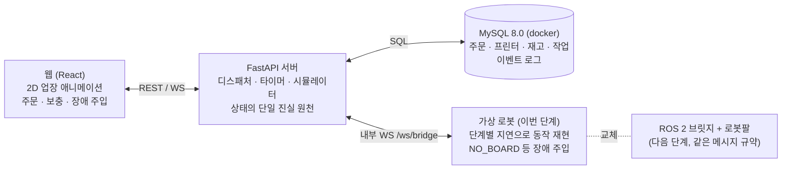
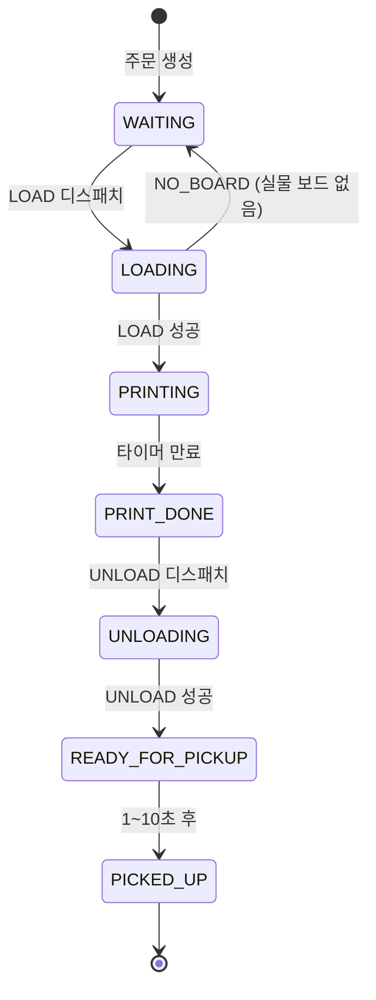

# PRD — 소규모 3D 프린트 업장 관리 로봇

작성일: 2026-11-12 · 작성자: 류병옥

## 1. 개요

두산 로보틱스 로봇팔 1대가 3D 프린터 3대를 관리하는 가상 업장을 만들고, 웹 2D 애니메이션과 로봇이 같은 이벤트 흐름으로 함께 움직이게 한다. 서버(FastAPI)가 주문·프린터·재고·작업 큐의 단일 진실 원천이며, 로봇은 서버가 보낸 작업 하나를 수행하고 진행 단계와 결과를 돌려준다.

### 이번 단계 범위

이번 단계는 ROS 2와 연동하지 않는다. 로봇팔은 가상 로봇 프로세스가 대신하며, 실제 로봇의 작업 시간을 반영한 단계별 지연으로 LOAD·UNLOAD를 흉내 낸다(7.7). 가상 로봇은 다음 단계의 ROS 2 브릿지와 같은 메시지 규약(7.4)을 쓰므로, 연동할 때 서버와 웹은 그대로 두고 가상 로봇 자리에 브릿지를 끼운다.

### 목표

- 45초 간격 자동 주문과 수동 주문을 받아, 빈 프린터에 보드를 넣고 출력이 끝나면 수령대로 옮기는 전체 흐름을 무인으로 돌린다.
- 로봇이 보내는 단계별 진행 이벤트로 웹 애니메이션의 로봇팔이 로봇과 같은 동작을 보여준다.
- 보드 부족, 로봇 작업 중 이벤트 대기, 실물 보드 없음 감지 같은 예외를 데이터 불일치 없이 처리한다.

### 범위 밖

- 실제 3D 프린팅 (프린터는 서버 타이머로 동작하는 가상 장치)
- 손님의 실제 수령 감지 (1~10초 랜덤 시뮬레이션)
- 로그인·결제·다중 매장
- ROS 2 연동과 실물 로봇 구동 (다음 단계)

### 용어

| 용어 | 뜻 |
| --- | --- |
| 보드 | 프린터에 넣는 출력판. 주문 1건 = 보드 1장 |
| 보드 적재대 | 오른쪽, 새 보드를 쌓아두는 곳 |
| 프린터 슬롯 | 가운데 위, 세로로 쌓인 3칸 (1층=맨 아래, 3층=맨 위) |
| 수령대 | 왼쪽, 완성된 보드를 놓는 곳 |
| LOAD 작업 | 적재대에서 보드를 집어 빈 프린터에 넣기 |
| UNLOAD 작업 | 출력 완료된 프린터에서 보드를 꺼내 수령대에 놓기 |
| 가상 로봇 | 이번 단계에서 로봇팔을 대신하는 별도 프로세스 |
| 브릿지 노드 | (다음 단계) FastAPI 서버와 ROS 2 사이에서 메시지를 변환하는 ROS 2 노드 |
| 작업 실행 노드 | (다음 단계) DSR 패키지로 로봇팔을 실제로 움직이는 ROS 2 노드 |

## 2. 시스템 구성

FastAPI 서버가 DB를 기준으로 다음 작업을 결정하고, 이번 단계에서는 가상 로봇이 그 작업을 받아 수행한다. ROS 2 브릿지와 실제 로봇팔은 다음 단계에서 같은 자리에 들어온다.



| 컴포넌트 | 책임 | 하지 않는 것 | 단계 |
| --- | --- | --- | --- |
| 웹 (React) | 상태 표시, 2D 애니메이션, 수동 주문, 보드 보충 확인, 장애 주입 디버그 패널 | 상태 판단, 타이머 계산 | 이번 |
| FastAPI 서버 | 주문 생성, 디스패치 판단, 프린터·수령 타이머, DB 갱신, 웹·로봇 이벤트 송신 | 로봇 동작 흉내 | 이번 |
| MySQL | 모든 상태와 이력 저장 | | 이번 |
| 가상 로봇 | 작업 수신, 단계별 지연 후 feedback·result 송신, 장애 주입 반영 | 다음 작업 선택, DB 접근 | 이번 |
| ROS 2 브릿지 노드 | 서버 메시지 ↔ ROS 2 Action/Topic 변환 | 큐 관리, 업무 판단 | 다음 |
| 작업 실행 노드 | 티칭 좌표 기반 LOAD/UNLOAD 모션, 그리퍼 파지 감지 | 다음 작업 선택 | 다음 |
| 두산 로봇팔 | 실제 동작 | | 다음 |

## 3. 업무 규칙

서버의 디스패처가 모든 규칙을 판정하고, 로봇이 IDLE일 때만 작업을 하나씩 내려보낸다. 로봇은 큐를 갖지 않는다.

### 주문

| 모양 | 코드 | 출력 시간 |
| --- | --- | --- |
| 세모 | TRIANGLE | 30초 |
| 네모 | SQUARE | 40초 |
| 별 | STAR | 50초 |
| 동그라미 | CIRCLE | 70초 |

- 자동 주문: 서버 스케줄러가 45초마다 가상 유저 1명과 랜덤 모양 주문 1건을 만든다. 시작·정지·간격은 웹에서 바꿀 수 있다.
- 수동 주문: 웹에서 모양을 고르거나 '랜덤'을 눌러 주문한다.
- 주문은 생성 즉시 DB에 INSERT되고 상태는 대기중(WAITING)이다. 출력 시간은 주문 시점 값으로 주문 행에 저장한다.

### 작업 디스패치 우선순위

로봇이 IDLE이 될 때마다 디스패처가 아래 순서로 다음 작업 하나를 고른다.

1. UNLOAD: 출력 완료(PRINT_DONE) 프린터가 있으면 먼저 꺼낸다. 여러 대면 먼저 완료된 순.
2. LOAD: 대기중 주문이 있고, 빈 프린터가 있고, 보드 재고가 1장 이상이며, 보드 보충 알럿이 떠 있지 않을 때. 가장 오래된 주문(FIFO)을 가장 아래층 빈 프린터에 넣는다.
3. 둘 다 없으면 대기한다.

이 순서가 요구사항의 "밀려있는 주문이 있으면 완료된 보드를 꺼낸 후 새 보드를 넣는다"를 만족한다. UNLOAD는 보드 재고와 무관하게 항상 진행한다.

### 이벤트 대기 (요구사항 9)

로봇이 작업 중일 때 발생한 주문 생성·출력 완료 이벤트는 버려지지 않고 DB 상태로 남는다. 디스패처는 로봇의 작업 결과를 받은 직후 위 우선순위를 다시 평가하므로, 대기 이벤트는 별도 메시지 큐 없이 순서대로 처리된다. 로봇 측(가상 로봇, 이후 브릿지)도 실행 중에 새 작업이 오면 거절해 이중 실행을 막는다.

### 프린터 타이머

- 타이머 시작 기준은 로봇의 LOAD 결과가 성공으로 돌아온 시각이다 (보드가 실제로 들어간 뒤).
- 서버가 started_at과 timer_ends_at을 저장하고, timer_ends_at에 주문을 출력 완료로 바꾼 뒤 UNLOAD 후보로 올린다.
- 서버가 재시작되면 DB의 timer_ends_at으로 타이머를 다시 건다.

### 보드 재고

- 재고 수량은 DB의 단일 행으로 관리하고, LOAD 성공 시점에 1 줄인다 (디스패치 시점이 아님).
- 재고가 0인데 LOAD 조건이 성립하면 로봇으로 보내지 않고, 웹에 '보드를 채워주세요' 알럿을 띄운다 (요구사항 10).
- 사용자가 보드를 채우고 수량을 입력해 확인을 누르면 재고를 갱신하고 알럿을 내린 뒤 디스패처를 다시 돌린다 (요구사항 11).
- 로봇이 LOAD 중 보드 없음을 감지하면(NO_BOARD), 서버는 주문을 대기중으로 되돌리고, 예약한 프린터를 비우고, DB 재고를 0으로 맞춘 뒤 알럿을 다시 띄운다 (요구사항 12). 실물과 DB가 어긋났다는 뜻이므로 실물 기준으로 맞춘다.

### 수령

- UNLOAD 성공 시 주문은 수령 대기(READY_FOR_PICKUP)가 되고, 서버가 1~10초 사이 정수 초를 뽑아 저장한다.
- 그 시간이 지나면 수령 완료(PICKED_UP)로 바꾸고 picked_up_at을 기록한다 (요구사항 13). 웹에서는 손님 캐릭터가 와서 가져간다.

## 4. 상태 머신

주문은 한 방향으로만 진행하고, 역방향은 LOAD 중 실물 보드가 없을 때(LOADING → WAITING) 하나뿐이다.



프린터 슬롯은 EMPTY → RESERVED(LOAD 디스패치) → PRINTING(LOAD 성공) → DONE(타이머 만료) → UNLOADING(UNLOAD 디스패치) → EMPTY(UNLOAD 성공) 순서로 주문과 함께 움직이며, NO_BOARD 시 RESERVED에서 EMPTY로 돌아간다. 로봇 상태는 IDLE, BUSY, ERROR, DISCONNECTED 4가지이고 디스패처는 IDLE일 때만 작업을 보낸다.

## 5. 기능 요구사항

원 요구사항 번호(R1~R13)를 함께 적었다. 우선순위 P0는 시연에 반드시 필요한 것, P1은 있으면 좋은 것이다.

| ID | 기능 | 상세 | 원 요구사항 | 담당 | 우선순위 |
| --- | --- | --- | --- | --- | --- |
| FR-01 | 자동 주문 생성 | 45초 간격 스케줄러, 가상 유저 생성, 랜덤 모양. 시작·정지·간격 변경 | 내용 | 서버 | P0 |
| FR-02 | 수동 주문 | 모양 4종 + 랜덤 버튼 | 내용 | 웹·서버 | P0 |
| FR-03 | 주문 저장 | 주문 INSERT 후 웹으로 order.created 전송 | R4, R5 | 서버 | P0 |
| FR-04 | 디스패처 | 로봇 IDLE 시 UNLOAD > LOAD 우선순위로 작업 1건 선택, robot_tasks에 기록, 로봇 쪽으로 전송 | R5, R6, R9 | 서버 | P0 |
| FR-05 | LOAD 작업 수행 | 7.7 단계 시간대로 진행, 단계별 feedback | R6 | 가상 로봇 | P0 |
| FR-06 | 프린터 타이머 | LOAD 성공 시 시작, 만료 시 PRINT_DONE 업데이트 + 이벤트 | R7 | 서버 | P0 |
| FR-07 | UNLOAD 작업 수행 | 7.7 단계 시간대로 진행, 단계별 feedback | R8 | 가상 로봇 | P0 |
| FR-08 | 작업 중 이벤트 대기 | 로봇 BUSY 동안 새 작업 미전송, 결과 수신 후 재평가. 로봇 측 중복 작업 거절 | R9 | 서버·가상 로봇 | P0 |
| FR-09 | 보드 부족 알럿 | 재고 0이면 LOAD 미전송 + 알럿 | R10 | 서버·웹 | P0 |
| FR-10 | 보드 보충 확인 | 알럿에서 보충 수량 입력 + 확인 → 재고 갱신 → 디스패처 재개 | R11 | 웹·서버 | P0 |
| FR-11 | 실물 보드 없음 처리 | NO_BOARD 결과 수신 시 주문 WAITING 복귀, 슬롯 해제, 재고 0, 알럿 | R12 | 가상 로봇(감지)·서버 | P0 |
| FR-12 | 수령 시뮬레이션 | 수령대 도착 후 1~10초 랜덤 뒤 PICKED_UP | R13 | 서버·웹 | P0 |
| FR-13 | 2D 업장 화면 | 배치·애니메이션은 8장 참고 | R1, R2 | 웹 | P0 |
| FR-14 | 로봇 동작 동기화 | 로봇 feedback 단계로 웹 로봇팔 애니메이션 구동 | R1 | 웹 | P0 |
| FR-15 | 상태 스냅샷 | 웹 접속·재접속 시 전체 상태 1회 수신 | 신규 | 서버 | P0 |
| FR-16 | 연결 상태 표시 | 로봇 쪽 연결, 로봇 상태(IDLE/BUSY/ERROR) 표시 | 신규 | 웹 | P1 |
| FR-17 | 이벤트 로그 패널 | 최근 이벤트 50건 시간순 표시 | 신규 | 웹 | P1 |
| FR-18 | 가상 로봇 | /ws/bridge 규약으로 접속하는 별도 프로세스, 단계 시간 설정 파일 | 신규 | 가상 로봇 | P0 |
| FR-19 | 장애 주입 | 디버그 패널: 실물 보드 수, NO_BOARD 1회, GRIP_FAIL 1회 | R12 | 웹·서버·가상 로봇 | P0 |
| FR-20 | 시간 배율 | 출력·수령·주문 간격·로봇 단계 시간에 공통 배율 적용 | 신규 | 서버 | P1 |
| FR-21 | 통계 | 처리 건수, 평균 대기·출력·수령 시간 | 신규 | 웹·서버 | P1 |

## 6. 데이터 모델 (MySQL 8.0)

테이블 6개로 구성한다. 모든 시각은 DATETIME(3)에 UTC로 저장하고 웹에서 KST로 변환해 보여준다. 서버·DB·컨테이너 어디서도 시간대 변환을 이중으로 하지 않도록 DB 세션 time_zone을 '+00:00'으로 고정한다.

### users — 가상 손님

| 컬럼 | 타입 | 설명 |
| --- | --- | --- |
| id | BIGINT PK AI | |
| name | VARCHAR(50) | 랜덤 생성 이름 (예: 손님-0012) |
| created_at | DATETIME(3) | |

### orders — 예약(주문)

| 컬럼 | 타입 | 설명 |
| --- | --- | --- |
| id | BIGINT PK AI | |
| user_id | BIGINT FK → users.id | |
| shape | ENUM('TRIANGLE','SQUARE','STAR','CIRCLE') | |
| print_duration_sec | INT | 주문 시점의 출력 시간 |
| status | ENUM('WAITING','LOADING','PRINTING','PRINT_DONE','UNLOADING','READY_FOR_PICKUP','PICKED_UP') | 4장 상태 머신 |
| source | ENUM('AUTO','MANUAL') | 주문 경로 |
| printer_slot | TINYINT NULL | 배정된 프린터 1~3 |
| created_at | DATETIME(3) | 요청 시각 |
| started_at | DATETIME(3) NULL | 작업(출력) 시작 시각 = LOAD 성공 시각 |
| print_completed_at | DATETIME(3) NULL | 출력 완료 시각 |
| ready_at | DATETIME(3) NULL | 수령대 도착 시각 = UNLOAD 성공 시각 |
| pickup_delay_sec | TINYINT NULL | 1~10 랜덤 |
| picked_up_at | DATETIME(3) NULL | 수령 시각 |
| updated_at | DATETIME(3) | |

인덱스: (status, created_at) — 디스패처의 FIFO 조회용.

### printers — 프린터 슬롯

| 컬럼 | 타입 | 설명 |
| --- | --- | --- |
| slot | TINYINT PK | 1(아래)~3(위) |
| status | ENUM('EMPTY','RESERVED','PRINTING','DONE','UNLOADING') | |
| current_order_id | BIGINT NULL FK | |
| timer_ends_at | DATETIME(3) NULL | 출력 종료 예정 시각 |
| updated_at | DATETIME(3) | |

### board_inventory — 보드 재고 (단일 행)

| 컬럼 | 타입 | 설명 |
| --- | --- | --- |
| id | TINYINT PK | 항상 1 |
| remaining_count | INT | 사용 가능한 남은 보드 수 |
| capacity | INT | 적재대 최대 수량 (가정 10) |
| refill_required | BOOLEAN | 보충 알럿 표시 중 여부 |
| updated_at | DATETIME(3) | |

### robot_tasks — 로봇 작업 큐·이력

| 컬럼 | 타입 | 설명 |
| --- | --- | --- |
| id | BIGINT PK AI | 로봇에 보내는 task_id |
| order_id | BIGINT FK | |
| type | ENUM('LOAD','UNLOAD') | |
| printer_slot | TINYINT | |
| status | ENUM('DISPATCHED','RUNNING','SUCCEEDED','FAILED','CANCELED') | |
| last_phase | VARCHAR(32) NULL | 마지막 feedback 단계 |
| error_code | VARCHAR(32) NULL | NO_BOARD, GRIP_FAIL, TIMEOUT 등 |
| dispatched_at / started_at / finished_at | DATETIME(3) NULL | |

동시에 DISPATCHED 또는 RUNNING인 행은 최대 1개다. 디스패처는 이 조건을 트랜잭션 안에서 SELECT ... FOR UPDATE로 확인한다.

### event_logs — 이벤트 기록

| 컬럼 | 타입 | 설명 |
| --- | --- | --- |
| id | BIGINT PK AI | |
| event_id | CHAR(36) UNIQUE | 메시지 봉투의 UUID, 중복 수신 방지 |
| type | VARCHAR(64) | 7장 이벤트 타입 |
| direction | ENUM('SERVER_TO_WEB','SERVER_TO_BRIDGE','BRIDGE_TO_SERVER') | |
| payload | JSON | |
| created_at | DATETIME(3) | |

요구사항 4의 상태 4개(작업중·대기중·수령 대기·수령 완료)는 orders.status에 그대로 들어 있고, 로봇 이동 중과 출력 완료 후 회수 대기를 구분하려고 LOADING, PRINT_DONE, UNLOADING 3개를 더했다. 화면에서는 아래처럼 묶어 보여줄 수 있다.

| orders.status | 화면 표기 |
| --- | --- |
| WAITING | 대기중 |
| LOADING, PRINTING | 작업중 |
| PRINT_DONE, UNLOADING | 작업중 (회수 대기) |
| READY_FOR_PICKUP | 수령 대기 |
| PICKED_UP | 수령 완료 |

## 7. 인터페이스 명세

인터페이스는 세 구간이다: 웹 ↔ 서버(REST + WebSocket), 서버 ↔ 로봇 쪽 프로세스(내부 WebSocket), 그리고 다음 단계의 브릿지 ↔ 작업 실행 노드(ROS 2 Action + Topic).

### 7.1 REST API (서버)

| 메서드 | 경로 | 요청 | 응답·동작 |
| --- | --- | --- | --- |
| POST | /api/orders | {"shape": "STAR" 또는 null(랜덤)} | 201, 생성된 주문. 수동 주문 |
| GET | /api/orders | ?status=&limit= | 주문 목록, 최신순 |
| GET | /api/state | | 전체 스냅샷 (프린터, 재고, 로봇, 대기 주문, 수령대) |
| POST | /api/inventory/refill | {"count": 10} | 재고를 count로 설정, refill_required=false, 디스패처 재개 |
| GET | /api/simulator | | 자동 주문 실행 여부, 간격, 시간 배율 |
| PATCH | /api/simulator | {"running": true, "interval_sec": 45, "time_scale": 1.0} | 설정 변경 |
| PATCH | /api/debug/faults | {"kind": "NO_BOARD", "once": true} 등 | 가상 로봇 장애 주입 (7.7) |
| GET | /api/stats | | 처리 건수, 평균 대기·출력·수령 시간 |
| GET | /api/health | | DB·로봇 쪽 연결 상태 |

### 7.2 WebSocket 공통 봉투

```json
{ "type": "order.updated", "event_id": "uuid", "ts": "2026-11-12T11:00:00.123Z", "data": { } }
```

수신 측은 event_id로 중복을 거른다.

### 7.3 서버 → 웹 (/ws/client)

| type | data | 발생 시점 |
| --- | --- | --- |
| state.snapshot | /api/state와 동일 | 접속 직후 |
| order.created | 주문 | 주문 INSERT 후 |
| order.updated | 주문 (status, 시각 포함) | 상태 변경마다 |
| printer.updated | slot, status, order_id, timer_ends_at | 슬롯 상태 변경 |
| inventory.updated | remaining_count, capacity | 재고 변경 |
| robot.state | state, current_task_id | 로봇 상태 변경 |
| robot.feedback | task_id, type, slot, phase, progress | 로봇 단계 변경 (애니메이션 구동) |
| alert.refill_required | reason: STOCK_EMPTY 또는 ROBOT_NO_BOARD | 요구사항 10, 12 |
| alert.cleared | | 보충 확인 후 |
| bridge.connection | connected: true/false | 로봇 쪽 연결 변화 |

### 7.4 서버 ↔ 로봇 쪽 프로세스 (/ws/bridge, 내부용)

로봇 쪽 프로세스가 클라이언트로 서버에 접속한다. 이번 단계는 가상 로봇이, 다음 단계는 ROS 2 브릿지가 같은 규약으로 접속한다. 토큰 헤더로 인증한다.

| 방향 | type | data |
| --- | --- | --- |
| 로봇 → 서버 | bridge.hello | mode: SIM(이번 단계) / ROS2(다음 단계), robot_state, current_task_id |
| 서버 → 로봇 | task.dispatch | task_id, type, slot, order_id |
| 로봇 → 서버 | task.accepted | task_id |
| 로봇 → 서버 | task.rejected | task_id, reason: BUSY 등 |
| 로봇 → 서버 | task.feedback | task_id, phase, progress |
| 로봇 → 서버 | task.result | task_id, success, error_code, message |
| 로봇 → 서버 | robot.state | state: IDLE/BUSY/ERROR/DISCONNECTED |
| 서버 → 로봇 | task.cancel | task_id (운영자 중단 시, P1) |
| 서버 → 로봇 | robot.fault | kind, once (가상 로봇 전용) |

hello의 current_task_id로 서버 재시작·재접속 후 진행 중 작업을 맞춘다.

### 7.5 ROS 2 인터페이스 (다음 단계, 참고용)

Action /printshop/execute_task — 타입 printshop_interfaces/action/ExecuteTask

```
# Goal
uint64 task_id
uint64 order_id
string task_type        # LOAD | UNLOAD
uint8  printer_slot     # 1~3
---
# Result
bool   success
string error_code       # NONE | NO_BOARD | GRIP_FAIL | MOTION_FAIL | ABORTED
string message
---
# Feedback
string phase
float32 progress        # 0.0~1.0, 작업 전체 기준
```

Topic /printshop/robot_state — 타입 printshop_interfaces/msg/RobotState, 2 Hz + 변경 시 즉시

```
string state            # IDLE | BUSY | ERROR
uint64 current_task_id
string last_error
```

### 7.6 feedback 단계 (phase) 정의

웹 애니메이션은 이 단계값으로 로봇팔의 목표 위치를 정한다. 로봇 쪽은 각 단계 시작 시점에 feedback을 1회 이상 보낸다.

| phase | LOAD | UNLOAD | 웹 로봇팔 목표 |
| --- | --- | --- | --- |
| MOVE_TO_STOCK | O | | 오른쪽 적재대 |
| PICK_BOARD | O | | 적재대에서 집기 (그리퍼 닫힘) |
| CHECK_GRIP | O | O | 파지 확인 (실패 시 NO_BOARD 또는 GRIP_FAIL) |
| MOVE_TO_PRINTER | O | O | 해당 층 프린터 |
| PLACE_IN_PRINTER | O | | 프린터에 넣기 (그리퍼 열림) |
| PICK_FROM_PRINTER | | O | 프린터에서 집기 |
| MOVE_TO_PICKUP | | O | 왼쪽 수령대 |
| PLACE_AT_PICKUP | | O | 수령대에 놓기 |
| RETURN_HOME | O | O | 가운데 홈 |

### 7.7 가상 로봇 (이번 단계)

가상 로봇은 /ws/bridge에 클라이언트로 접속하는 별도 Python 프로세스(docker compose 서비스 virtual-robot)다. task.dispatch를 받으면 아래 단계를 순서대로 진행하며 단계 시작마다 task.feedback을, 끝나면 task.result를 보낸다. 실행 중 새 task.dispatch가 오면 task.rejected(BUSY)를 보낸다.

단계 시간 기본값은 협동 로봇 픽앤플레이스 속도를 가정한 값이며, 설정 파일로 바꿀 수 있다. 모든 값에 시간 배율(FR-20)이 곱해진다.

| phase | LOAD (초) | UNLOAD (초) |
| --- | --- | --- |
| MOVE_TO_STOCK | 3 | — |
| PICK_BOARD | 2 | — |
| CHECK_GRIP | 1 | 1 |
| MOVE_TO_PRINTER | 3 + 층 보정 | 3 + 층 보정 |
| PLACE_IN_PRINTER | 2 | — |
| PICK_FROM_PRINTER | — | 2 |
| MOVE_TO_PICKUP | — | 4 |
| PLACE_AT_PICKUP | — | 2 |
| RETURN_HOME | 3 | 3 |
| 합계 | 14~16 | 15~17 |

층 보정은 1층 0초, 2층 +1초, 3층 +2초다. progress = 작업 경과 시간 / 작업 전체 시간.

장애 주입은 웹 디버그 패널 → PATCH /api/debug/faults → 서버가 가상 로봇에 robot.fault {kind, once} 전달 순으로 동작한다.

- 실물 보드 수: 가상 로봇은 DB와 별개로 '실물 보드 수'를 갖고, LOAD 때 0이면 CHECK_GRIP에서 실패해 보드 없이 RETURN_HOME 후 Result(NO_BOARD)를 보낸다. 보충 알럿 확인 시 기본으로 입력 수량만큼 실물도 채우고, 디버그 패널의 '실물은 채우지 않음' 옵션으로 요구사항 12 상황을 만든다.
- NO_BOARD 1회: 다음 LOAD 1회를 강제로 실패시킨다.
- GRIP_FAIL 1회: 다음 UNLOAD 1회를 실패시킨다.
- 연결 끊김: 가상 로봇 프로세스를 재시작해 확인한다.

robot.fault와 /api/debug/faults는 가상 로봇 전용이며 ROS 2 연동 후에는 쓰지 않는다.

## 8. 웹 UI

한 화면짜리 2D 게임풍 대시보드다. 화면은 서버 이벤트만 보고 그리며, 자체 타이머로 상태를 바꾸지 않는다 (카운트다운 표시는 timer_ends_at 기준 계산).

### 8.1 레이아웃

```
┌──────────────────────── 상단 바 ─────────────────────────┐
│ 자동주문 ON/OFF · 간격 · 시간배율 · 로봇 상태 · 통계       │
├──────────────────────────────────────────────────────────┤
│                    [ 프린터 3층 ]                        │
│                    [ 프린터 2층 ]                        │
│                    [ 프린터 1층 ]                        │
│  [수령대]            [로봇팔]             [보드 적재대]  │
│  손님 캐릭터                               남은 보드 n장  │
├──────────────────────────────────────────────────────────┤
│ 주문하기(세모·네모·별·동그라미·랜덤) │ 대기 큐 │ 이벤트 로그 │ 디버그 │
└──────────────────────────────────────────────────────────┘
```

### 8.2 요소별 표현

| 요소 | 표현 | 상태 변화 |
| --- | --- | --- |
| 프린터 (3층) | 픽셀풍 프린터, 창에 출력 중인 모양 아이콘 | EMPTY 회색 · PRINTING 진행바 + 남은 초 · DONE 깜빡임 |
| 로봇팔 | 베이스 + 2관절 팔 + 그리퍼, 가운데 아래 고정 | robot.feedback 단계별 목표 위치로 이동, 들고 있는 보드 표시 |
| 보드 적재대 | 보드 더미, 남은 수 숫자 | 0장이면 빨간 테두리 |
| 수령대 | 완성품 보드가 놓이는 칸 | 수령 대기 보드 위에 주문번호 |
| 손님 | 작은 캐릭터 | 주문 시 입장 → 대기 줄 → 수령 시 보드 들고 퇴장 |
| 대기 큐 | 주문 카드 (번호, 모양, 대기 시간) | FIFO 순서 |
| 이벤트 로그 | 시각 + 메시지 한 줄 | 최근 50건 |
| 디버그 패널 | 실물 보드 수, NO_BOARD 1회, GRIP_FAIL 1회 | 장애 주입 (7.7) |

### 8.3 로봇팔 애니메이션 동기화

- 단계별 목표 자세(관절 각도 또는 끝점 좌표)를 프론트 상수로 정의한다: HOME, STOCK, PRINTER_1~3, PICKUP.
- feedback이 오면 현재 자세에서 목표 자세로 보간 이동한다. 이동 시간은 7.7의 단계 시간(시간 배율 반영)을 쓰고, 다음 feedback이 먼저 오면 그 즉시 다음 목표로 넘어간다.
- 결과(task.result) 수신 시 홈 자세로 맞춰 오차를 리셋한다.
- 구현 후보: React + SVG/Canvas, 애니메이션은 framer-motion 또는 requestAnimationFrame. 게임 엔진(Phaser)은 필요 시 검토.

### 8.4 보드 보충 알럿

- alert.refill_required 수신 시 모달: "보드를 채워주세요", 보충 수량 입력(기본값 capacity), 확인 버튼.
- reason이 ROBOT_NO_BOARD이면 "로봇이 보드를 찾지 못했습니다. 적재대를 확인하고 채워주세요"로 문구를 구분한다.
- 확인 → POST /api/inventory/refill → alert.cleared 수신 시 모달 닫힘. 여러 탭에서 열려 있어도 한 곳에서 확인하면 모두 닫힌다.
- 알럿 중에도 UNLOAD와 수령은 계속 진행된다.

## 9. 주요 시퀀스와 예외 처리

### 9.1 정상 흐름 (주문 1건)

1. 주문 생성 → orders INSERT (WAITING) → 웹에 order.created.
2. 디스패처: 로봇 IDLE, 빈 슬롯 있음, 재고 ≥ 1 → 트랜잭션으로 슬롯 RESERVED, 주문 LOADING, robot_tasks(LOAD, DISPATCHED) 저장 → 가상 로봇에 task.dispatch.
3. 가상 로봇이 단계별로 진행. feedback마다 서버 → 웹 robot.feedback.
4. LOAD 성공 → 재고 −1, 주문 PRINTING + started_at, 슬롯 PRINTING + timer_ends_at, 타이머 등록 → 디스패처 재평가.
5. 타이머 만료 → 주문 PRINT_DONE + print_completed_at, 슬롯 DONE → 디스패처 재평가 (로봇 BUSY면 대기).
6. UNLOAD 디스패치 → 주문 UNLOADING → 성공 시 READY_FOR_PICKUP + ready_at, 슬롯 EMPTY, pickup_delay_sec 랜덤 → 디스패처 재평가.
7. pickup_delay_sec 경과 → PICKED_UP + picked_up_at.

### 9.2 로봇 작업 중 이벤트 (요구사항 9)

로봇이 LOAD 중일 때 2번 프린터 타이머가 끝나고 새 주문도 들어온 경우: 두 이벤트는 DB 상태로만 반영된다. LOAD 결과 수신 후 디스패처는 UNLOAD(2번)를 먼저 보내고, 그 결과 수신 후 대기 주문 LOAD를 보낸다.

### 9.3 재고 0 (요구사항 10, 11)

1. 디스패처가 LOAD를 고르려는데 재고 0 → 전송하지 않고 refill_required=true, 웹에 alert.refill_required(STOCK_EMPTY).
2. 사용자가 보드를 채우고 수량 입력 + 확인 → POST /api/inventory/refill.
3. 서버: 재고 갱신, refill_required=false, alert.cleared → 디스패처 재평가 → LOAD 디스패치.

### 9.4 실물 보드 없음 (요구사항 12)

1. LOAD 중 CHECK_GRIP 단계에서 가상 로봇의 실물 보드 수가 0이거나 NO_BOARD 장애가 주입됨 → 보드 없이 홈 복귀 후 Result(success=false, NO_BOARD). 다음 단계에서는 작업 실행 노드의 그리퍼 파지 감지가 이 역할을 한다.
2. 서버 트랜잭션: robot_tasks FAILED, 주문 WAITING + printer_slot NULL, 슬롯 EMPTY, 재고 0, refill_required=true.
3. 웹에 order.updated, printer.updated, inventory.updated, alert.refill_required(ROBOT_NO_BOARD).
4. 이후는 9.3의 2~3번과 같다.

### 9.5 기타 예외

| 상황 | 감지 | 처리 |
| --- | --- | --- |
| 로봇 쪽 연결 끊김 | WebSocket close, 하트비트 10초 무응답 | 디스패처 정지, 웹에 bridge.connection=false. 진행 중 작업은 재접속 hello로 대조 |
| 작업 타임아웃 | 디스패치 후 결과 없음 (기본 120초) | 작업 FAILED(TIMEOUT), 로봇 ERROR 표시, 운영자 확인 후 수동 복구 |
| UNLOAD 파지 실패 | Result GRIP_FAIL | 주문·슬롯은 PRINT_DONE/DONE 유지, 로봇 ERROR, 운영자 확인 후 재시도 버튼 (P1) |
| 모션 실패·비상정지 | Result MOTION_FAIL 또는 robot_state ERROR | 디스패처 정지, 웹 경고. 로봇 복구 후 IDLE 수신 시 재개 |
| 로봇이 BUSY 중 작업 수신 | 로봇 쪽 자체 상태 | task.rejected(BUSY) → 서버는 작업을 다시 큐 후보로 되돌림 |
| 서버 재시작 | 기동 시 | DB에서 타이머·수령 예약 복원, DISPATCHED/RUNNING 작업은 hello와 대조 |
| 중복 이벤트 | event_id, task_id | 이미 처리한 event_id·종료된 task_id 결과는 무시 |

## 10. 비기능 요구사항·환경·일정

### 10.1 비기능 요구사항

| 항목 | 기준 |
| --- | --- |
| 웹 반영 지연 | 서버 상태 변경 후 웹 표시까지 500ms 이내 (로컬 네트워크) |
| 타이머 정확도 | 출력·수령 타이머 오차 ±1초 |
| 일관성 | 디스패치·결과 반영은 DB 트랜잭션 1개로 처리, 동시 실행 작업 최대 1개 |
| 복구 | 서버 재시작 후 주문·타이머·작업 상태가 DB 기준으로 복원 |
| 로봇 안전 (다음 단계) | 협동 모드 속도 제한, 비상정지 버튼 상시 접근, 시연 중 작업 반경 출입 통제 |
| 관측성 | 모든 WebSocket 메시지를 event_logs에 저장, 서버 로그에 task_id 포함 |

### 10.2 처리량 점검

주문 간격 45초, 평균 출력 시간 47.5초, 프린터 3대이므로 프린터 용량은 충분하다. 병목은 로봇이다: 7.7 기본값으로 주문 1건당 로봇 시간은 LOAD 14~16초 + UNLOAD 15~17초 = 29~33초로 45초 안에 들어와 대기열이 쌓이지 않는다. 다음 단계에서 실제 로봇 시간을 측정해 7.7 값을 교체하고, 45초를 넘으면 시간 배율(FR-20)로 주문 간격을 늘린다.

### 10.3 기술 스택·실행 환경

| 구분 | 선택 | 단계 |
| --- | --- | --- |
| 프론트엔드 | React + TypeScript + Vite, SVG 기반 2D 애니메이션 | 이번 |
| 서버 | FastAPI (Python 3.12), SQLAlchemy 2.x async + aiomysql, Alembic 마이그레이션, asyncio 기반 타이머·스케줄러 | 이번 |
| DB | MySQL 8.0, docker compose로 로컬 구동 (볼륨 마운트, 초기 시드: 프린터 3행, 재고 1행) | 이번 |
| 가상 로봇 | Python 3.12 + websockets 클라이언트, 단계 시간 YAML 설정, docker compose 서비스 | 이번 |
| ROS 2 브릿지 | rclpy + websockets 클라이언트 | 다음 |
| 로봇 제어 | 두산 doosan-robot2 (DSR ROS 2), Ubuntu 24.04 + ROS 2 Jazzy (가정) | 다음 |

### 10.4 역할 분담

| 영역 | 담당 | 산출물 | 단계 |
| --- | --- | --- | --- |
| 웹·서버·DB | 류병옥 | React 앱, FastAPI, 스키마·마이그레이션, 디스패처, 시뮬레이터 | 이번 |
| 가상 로봇 | 류병옥 (가정) | virtual-robot 프로세스, 단계 시간 설정, 장애 주입 | 이번 |
| 인터페이스 정의 | 공동 | 7.4 메시지 규약 확정 (가상 로봇과 ROS 2 브릿지 공용) | 이번 |
| ROS 2 브릿지·작업 실행 노드 | ROS 2 담당자 | printshop_interfaces, bridge_node, 티칭 좌표, LOAD/UNLOAD 시퀀스, 그리퍼 파지 감지 | 다음 |
| 하드웨어 배치 | ROS 2 담당자 | 적재대·프린터 거치대·수령대 물리 배치 | 다음 |

### 10.5 가정

- 보드 1장 = 주문 1건, 완성품은 보드째 수령대로 옮긴다.
- 보드 초기 수량과 적재대 최대 수량은 10장이다.
- 수령대는 수령 대기 보드를 모두 놓을 공간이 있다 (1~10초 내 수령되므로 동시 2장 이하 예상).
- 빈 프린터가 여럿이면 아래층부터 채운다.
- 대기 주문 수에 상한이 없다.

### 10.6 미결 사항

- [ ] 7.7 단계 시간 기본값을 그대로 쓸지, ROS 2 담당자에게 예상 시간을 받아 맞출지
- [ ] 웹 화면을 여러 대에서 동시에 볼지, 조작 권한을 나눌지
- [ ] UNLOAD 파지 실패 시 자동 재시도 횟수
- [ ] (다음 단계) 로봇 모델·그리퍼 모델, ROS 2 배포판과 DSR 패키지 버전
- [ ] (다음 단계) 실물 수령대 칸 수, 가득 찼을 때 UNLOAD를 멈출지 여부

### 10.7 마일스톤

1. M1 서버 기반: 스키마·시드, 주문·재고 API, 디스패처, 타이머, 시뮬레이터.
2. M2 가상 로봇: /ws/bridge 규약, 단계 시간 진행, 장애 주입, 재접속 복구.
3. M3 웹 화면: 레이아웃, WebSocket 연동, 로봇팔 단계 애니메이션, 보충 알럿, 디버그 패널.
4. M4 시나리오 테스트·시연: 9장 시퀀스 전부, 30분 연속 운전.
5. 다음 단계: ROS 2 브릿지로 가상 로봇 교체, 실물 연동, 실제 동작 시간 측정과 7.7 값 보정.