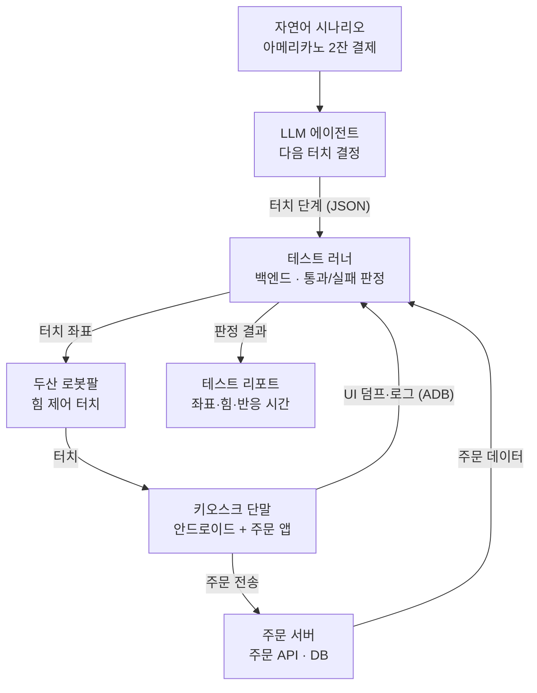

# 키오스크·POS 물리 QA 자동화 로봇

## 1. 아이디어 제목

**TouchBot QA: 협동로봇 기반 키오스크·POS 실물 단말 자동 테스트 시스템**

두산 협동로봇이 사람 대신 키오스크·POS 화면을 일정한 힘으로 터치하고, 단말 로그와 서버 데이터로 결과를 판정해 실물 단말 회귀 테스트를 무인으로 반복하는 시스템이다.

## 2. 문제

키오스크·POS·결제 단말처럼 실제 하드웨어에서만 확인할 수 있는 제품은 QA를 사람이 손으로 반복하고 있다.

- **반복 비용:** 펌웨어·앱을 배포할 때마다 주문→옵션 선택→결제→영수증 같은 동일 시나리오를 QA 인력이 직접 눌러 확인한다. 단말 기종과 해상도가 늘수록 테스트 시간이 곱으로 늘어난다.
- **소프트웨어 자동화의 한계:** 웹은 Playwright, 앱은 에뮬레이터로 자동화할 수 있지만, 터치 패널 인식, 카드 리더기·프린터 연동, 펌웨어 반응 속도처럼 실물에서만 나타나는 문제는 잡지 못한다.
- **품질 편차:** 사람마다 누르는 위치·힘·속도가 달라 재현이 어렵고, 피로가 쌓이면 누락이 생긴다. 버그 재현 절차도 기록으로 남지 않는다.
- **내구·야간 테스트 불가:** 수천 번 반복 터치나 밤사이 회귀 테스트는 사람이 하기 어렵다.

## 3. 해결

카메라 없이, 사람의 "보고 → 누르고 → 확인하는" QA 루프를 로봇팔의 힘 센서, 단말 내부 정보, 서버 데이터로 옮겨 실물 단말 테스트를 웹 E2E 테스트처럼 자동으로 돌린다.

| 사람이 하던 일 | 시스템이 대신하는 방법 (카메라 없음) |
| --- | --- |
| 화면에서 버튼 찾기 | 키오스크 앱의 UI 구조(안드로이드 `uiautomator dump`의 요소별 좌표 또는 화면 설계 좌표)에서 버튼 픽셀 좌표를 얻고, 캘리브레이션으로 로봇 좌표(mm)로 변환 |
| 손가락으로 누르기 | 로봇팔이 스타일러스로 터치. 힘 제어로 항상 같은 힘만 가하고, 힘 센서로 접촉 순간을 감지 |
| 시나리오 문서 보며 따라하기 | "아메리카노 2잔 카드 결제" 같은 자연어 시나리오를 LLM 에이전트가 UI 구조를 보고 터치 단계로 변환 |
| 눈으로 결과 확인 | 터치 후 화면 상태(UI 덤프·앱 로그)와 주문 서버의 주문 데이터를 기대값과 비교해 통과/실패 판정 |
| 버그 리포트 작성 | 단계별 터치 좌표·힘 로그·반응 시간·실패 지점을 리포트로 자동 저장 |

카메라 판정보다 오히려 정확하다. 화면이 맞게 보여도 주문이 서버에 잘못 들어가는 버그까지 잡을 수 있기 때문이다. 좌표를 하드코딩하지 않고 UI 구조에서 매번 버튼을 찾기 때문에, 화면 배치가 바뀌어도 시나리오를 그대로 재사용할 수 있다.

## 4. 방법

테스트 러너(백엔드)가 로봇과 키오스크를 동시에 제어한다. 로봇에는 "어디를 누를지"를 보내고, 키오스크와 주문 서버에서는 "누른 뒤 무엇이 바뀌었는지"를 읽는다.



결과는 화면을 찍어서 확인하지 않는다. 단말의 UI 덤프·로그와 주문 서버 데이터를 읽어 판정한다.

### 4-1. 하드웨어 구성

- 두산 협동로봇 + OnRobot 그리퍼(실습 장비 그대로)
- 정전식 스타일러스: 그리퍼가 잡거나 툴에 고정. 로봇이 잡으면 사람 몸의 정전용량이 없어 터치가 안 먹힐 수 있으므로, 도전성 팁을 선으로 접지한다
- 테스트 대상: 안드로이드 태블릿에 키오스크 앱(직접 만든 카페 주문 앱)을 올려 거치대에 고정. USB로 PC와 연결해 ADB 사용

### 4-2. 캘리브레이션: 화면 픽셀 → 로봇 좌표

카메라 대신 단말의 터치 기록을 이용한다.

1. 힘 제어로 천천히 내려가다가 접촉을 감지해 화면의 높이(Z)를 찾는다. 실습의 기어 끼우기에서 쓴 방식과 같다.
2. 화면 위 서로 다른 3점 이상을 터치하고, 단말의 터치 이벤트(`adb shell getevent`)에서 실제로 눌린 픽셀 좌표를 읽는다.
3. (로봇 X, Y) ↔ (픽셀 x, y) 쌍으로 변환 행렬(아핀 변환)을 구한다. 이후에는 어떤 픽셀이든 로봇 좌표로 바꿀 수 있다.

### 4-3. 터치 동작 (DRL)

아래는 구조를 보여주기 위한 의사코드이며, 값은 실습 환경에서 조정한다.

```python
def tap(x, y, hold=0.1):
    movel(posx(x, y, Z_SAFE, RX, RY, RZ))          # 버튼 위 접근점
    task_compliance_ctrl([3000, 3000, 500, 200, 200, 200])
    set_desired_force([0, 0, -3, 0, 0, 0], [0, 0, 1, 0, 0, 0])  # 3N으로 누르기
    while not check_force_condition(DR_AXIS_Z, min=2.5):     # 접촉 감지
        pass
    wait(hold)                                     # 짧게 누름 / 길게 누름
    release_force(); release_compliance_ctrl()
    movel(posx(x, y, Z_SAFE, RX, RY, RZ))          # 다시 위로
```

로봇 쪽은 `tap`, `swipe`, `long_press` 세 동작만 제공하고, 백엔드가 좌표를 보내 호출한다. 통신은 두산의 ROS 2 패키지(doosan-robot2)를 쓰거나, DRL의 TCP 소켓 서버로 명령을 받는다.

### 4-4. 버튼 위치와 시나리오

- `adb shell uiautomator dump`로 현재 화면의 요소 목록(텍스트, 좌표 범위)을 XML로 받는다.
- LLM 에이전트에 자연어 시나리오와 현재 화면 요소 목록을 주면, 다음에 누를 요소와 기대 결과를 구조화된 형태(JSON)로 돌려준다.
- 한 번 성공한 단계 목록은 저장해 두고, 이후 회귀 테스트에서는 LLM 없이 그대로 재실행한다(비용·속도·재현성).

### 4-5. 결과 판정 (3단계)

| 단계 | 확인 방법 | 잡는 문제 |
| --- | --- | --- |
| 터치 | 힘 센서 접촉 감지 + `getevent` 터치 이벤트 | 터치 미인식, 엉뚱한 위치 눌림 |
| 화면 | 터치 후 UI 덤프·앱 로그(logcat)에 기대한 화면·문구가 있는지 | 화면 전환 오류, 버튼 무반응 |
| 서버 | 주문 서버 API/DB에 메뉴·수량·금액이 맞게 들어갔는지 | 금액 계산 오류, 중복 주문 |

터치 접촉 시각과 화면 변화 로그 시각의 차이로 반응 속도(ms)도 함께 기록한다.

### 4-6. 단계별 구현 계획

1. 로봇이 힘 제어로 화면 한 점을 누르고 올라오기 (DRL만)
2. 3점 캘리브레이션으로 원하는 픽셀 누르기
3. 백엔드에서 로봇에 좌표 전송 + ADB로 UI 덤프·로그 수집
4. 고정 시나리오 1개(아메리카노 주문) 자동 실행 + 서버 판정 + 리포트
5. LLM 에이전트로 자연어 시나리오 확장, 반복 내구 테스트 모드

## 5. 기대효과

수동 QA를 무인 자동 실행으로 바꿔 배포 주기를 단축하고, 실물에서만 나타나는 버그를 출시 전에 잡는다.

- **QA 인건비 절감:** 배포마다 반복하던 회귀 테스트를 로봇이 밤사이에 돌리고, QA 인력은 새 기능·탐색적 테스트에 집중한다.
- **배포 속도 향상:** 펌웨어·앱 빌드가 나오면 CI에서 자동으로 실물 테스트까지 돌 수 있어, 수동 확인을 기다리는 시간이 줄어든다.
- **장애 비용 감소:** 결제 금액 오류나 주문 누락처럼 매장 매출에 바로 영향을 주는 버그를 서버 데이터까지 확인해 출시 전에 막는다. 단말이 수백~수천 대 배포된 뒤에는 현장 대응 비용이 크다.
- **재현 가능한 품질 기록:** 단계별 좌표·힘·반응 시간이 남아 "버그가 재현되지 않는다"는 논쟁이 줄고, 버전별 반응 속도 변화도 추적할 수 있다.
- **내구 테스트:** 같은 버튼을 수천 번 일정한 힘으로 눌러 터치 패널·앱 안정성을 검증한다.
- **확장성:** 같은 구조로 배달 주문 단말, 차량 인포테인먼트, 의료기기 터치 UI, 스마트폰 앱 테스트로 넓힐 수 있다. 카메라가 없어 장비 비용이 낮고 조명 환경의 영향도 받지 않는다.